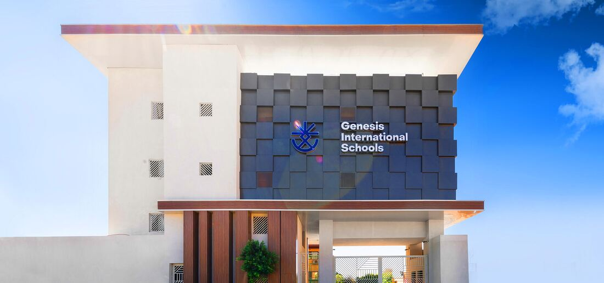

## من مينيس إلى جينيسيس

تأسست مدارس مينيس الدولية عام 1990 بهدف تقديم تعليم عالي الجودة للطلاب، مع التركيز على تكافؤ الفرص والتميّز. ومنذ ذلك الحين بنت المدرسة سمعة رفيعة، وأصبحت تُعدّ اليوم من أعرق المؤسسات التعليمية في البلاد. وقد منح تاريخ مينيس الطويل المدرسةَ إرثًا من الخبرة والكفاءة جعل منها اسمًا محترمًا في المجتمع التعليمي.

ورثت جينيسيس هذا الإرث، حاملةً معها أكثر من 30 عامًا من الخبرة والتطلعات العالية. وتتمحور فلسفة التعليم في جينيسيس حول تكوين أفراد متفرّدين قادرين على أن يعيشوا حياة سعيدة ومُرضية، وذلك من خلال برامج وأنشطة تعليمية ثرية صُممت لمساعدة الطلاب على بلوغ أقصى إمكاناتهم وتنمية حبّهم للتعلّم.

تلتزم جينيسيس بتقديم تعليم يجمع بين الجدية والمتعة. ويحرص المعلمون والعاملون في المدرسة على مساعدة الطلاب على النمو والتطور أكاديميًا وشخصيًا. وسواء من خلال التعلّم القائم على التجربة، أو المقررات الدراسية المليئة بالتحدي، أو الأنشطة اللاصفية، تتيح جينيسيس لطلابها فرصًا وفيرة لاستكشاف اهتماماتهم وتنمية مهاراتهم.

في جينيسيس، ينصبّ التركيز على مساعدة الطلاب ليصبحوا أفرادًا متكاملين قادرين على النجاح في أي طريق يختارونه، سواء في الجامعة أو في سوق العمل أو في حياتهم الشخصية؛ فالتعليم الذي يتلقونه في جينيسيس يمنحهم أساسًا للنجاح يرافقهم مدى الحياة. والهدف هو تكوين أفراد واثقين ومثقفين وأكفاء، قادرين على إحداث أثر إيجابي في العالم.

## الرسالة والرؤية

### الرسالة

توفير بيئة تعلّم مستدامة من خلال توظيف أحدث التطورات التكنولوجية، بما يؤدي إلى أداء متميز للمهام ونموّ مهني في مجال التعليم.

### الرؤية

تمكين الطلاب من اكتشاف ذواتهم، وتنمية القيم والقدرات الأساسية للمتعلّم مدى الحياة في بيئة عالمية ومستدامة، مع الحفاظ على هوية المؤسسة وإرثها.

## قيم مدارس جينيسيس

### القيادة المُلهِمة للتغيير

«بالإلهام يولد جيل جديد». من خلال تقديم قيم القيادة الناجحة بالقدوة ومشاركة الموارد، تعمل جينيسيس على تشكيل مجتمع جديد من القادة والمبادرين وقصص النجاح.

### المسؤولية المجتمعية

تطبّق جينيسيس أدوات التنمية المستدامة التي تقدّمها الأمم المتحدة لتنمية مجتمعنا من المفكرين من خلال الابتكار والنزاهة والتفرّد.

### التميّز المستمر

لأن التشجيع دواء مهم في أي مجتمع، فإننا نحتفي بإنجازات طلابنا ومعلمينا في الأنشطة التعليمية واللاصفية على حدّ سواء.

### التعاون

لتوفير بيئة ثرية ومتنامية باستمرار لطلابنا ومعلمينا وأولياء الأمور، تتعاون جينيسيس مع أحدث الأدوات التعليمية.

### التعلّم الممتع (Edutainment)

نؤمن بشدة أن التعليم يجب أن يتضمن دائمًا عنصر المتعة. فهذا الأسلوب يضمن أن يستمتع الطالب والمعلم معًا بالموضوع ويتعلّماه، ويسهم في تجربة تعلّم مبدعة ومتقدمة.

## ملامح خرّيج جينيسيس

في مدارس جينيسيس الدولية نُعدّ خريجينا للتفوق في عالم سريع التغيّر. ويجسّد خرّيج جينيسيس التميّز الأكاديمي والقيادة الأخلاقية والمواطنة العالمية والرفاه. ويخرج طلابنا متعلّمين واثقين مستعدين للمستقبل، يمتلكون المهارات والقيم وأنماط التفكير اللازمة لعيش حياة ذات معنى والإسهام في عالم عادل ومستدام.

**تُخرّج مدارس جينيسيس الدولية طلابًا:**

### أولًا: متعلّمون أكفاء أكاديميًا ومحبّون للمعرفة

طلاب جينيسيس:

- يُتقنون المواد الأكاديمية الأساسية (الرياضيات والعلوم واللغة الإنجليزية والدراسات الاجتماعية ولغة ثانية: الفرنسية أو الألمانية) وفق المعايير الدولية (Common Core وNGSS وCEFR ومعايير AP)
- يطبّقون التفكير النقدي والبحث وحلّ المشكلات في جميع المواد
- يُجيدون ثلاث لغات على الأقل: العربية والإنجليزية والألمانية أو الفرنسية، مع اعتماد الإنجليزية لغةً أساسية للتدريس.
- يستخدمون الأدوات الرقمية والتقنيات الناشئة بفاعلية ومسؤولية
- يُقبلون في جامعات مرموقة مثل **AUC وGUC وGIU وBUE وEUE وASU**، ويدرسون تخصصات **الهندسة والطب والصيدلة والقانون وعلوم الحاسب والعلوم السياسية وعلم النفس**
- يحصل بعضهم على **منح دراسية قائمة على التفوق** بفضل إنجازاتهم الأكاديمية و**ملفات القيادة** الخاصة بهم

### ثانيًا: مفكرون ومبتكرون في القرن الحادي والعشرين

خرّيجو جينيسيس:

- يُتقنون مهارات القرن الحادي والعشرين: التفكير النقدي والإبداع والتواصل والتعاون
- يتمتعون بروح ريادية، ويركّزون على الحلول، ويتكيّفون مع التغيير
- يشاركون في البرمجة والروبوتات ومعارض العلوم وتحديات التصميم
- يوظّفون الابتكار لحلّ مشكلات واقعية، مع التركيز على مجالات مثل الصحة والرفاه وجودة التعليم والاستدامة البيئية.

### ثالثًا: مواطنون عالميون أصحاب رسالة

خرّيجو جينيسيس:

- يقدّرون التنوّع ويتمتعون بالوعي الثقافي واحترام الآخرين
- يفهمون أهداف الأمم المتحدة للتنمية المستدامة (SDGs) ويدعمونها من خلال المشروعات المدرسية والتعلّم بالخدمة
- يشاركون في برامج عالمية مثل نموذج الأمم المتحدة (GMUN) وبرامج التبادل الدولي
- يعزّزون العدالة والمسؤولية البيئية وتكافؤ الفرص محليًا وعالميًا

### رابعًا: واعون اجتماعيًا وعاطفيًا ومُلمّون بمفاهيم الرفاه

خرّيجو جينيسيس:

- ينمّون الذكاء العاطفي والوعي الذاتي والمرونة من خلال منهج Leader in Me القائم على العادات السبع لستيفن كوفي
- يعتنون برفاههم البدني والذهني والعاطفي وفق إطار CASTLE للتعلّم الاجتماعي العاطفي
- يُظهرون القيادة في الخدمة والدراسة والتعبير عن صوت الطلاب عبر منصات مثل اتحاد طلاب جينيسيس (GSU)
- يتحلّون بالثقة والمسؤولية والدافعية الذاتية في جميع مواقف التعلّم.
- يُظهرون تعاطفًا حقيقيًا من خلال المشاركة الفعالة في الفعاليات الخيرية ومبادرات خدمة المجتمع.
- يشاركون بجدية في العمل الخيري، ويكونون قدوة للطلاب الأصغر سنًا بتوجيههم وتشجيعهم على المشاركة في خدمة المجتمع.

### خامسًا: مبتكرون ومستعدون للمستقبل

طلاب جينيسيس:

- يتعلّمون مجالات STEM وSTEAM من خلال التعلّم القائم على الاستقصاء
- يشاركون في تحديات الروبوتات والبرمجة والتفكير التصميمي
- يُظهرون الإبداع وروح الريادة والقدرة على التكيّف في حلّ المشكلات الواقعية
- يتمتعون بالثقافة الرقمية ومستعدون للتعليم العالي أو للمسارات المهنية العالمية

### خامسًا: متعلّمون مدى الحياة ومفكرون متأمّلون

طلاب جينيسيس:

- يضعون أهدافًا شخصية ويقيّمون نموّهم بأنفسهم
- يطلبون التغذية الراجعة وينظرون إلى التحديات بوصفها فرصًا للتعلّم
- ينخرطون في الاستقصاء والتأمل والتعلّم الذاتي
- يُظهرون الفضول والالتزام بالتحسين المستمر

### سادسًا: قادة أخلاقيون يتحلّون بالنزاهة والمبادرة

خرّيجو جينيسيس:

- يعيشون وفق القيم الأساسية للمدرسة: الاحترام والمسؤولية والتميّز
- يتخذون قراراتهم بروح استباقية وهادفة ومبدئية
- يقودون بالقدوة، ويرشدون الآخرين، ويسهمون في ثقافة مدرسية إيجابية
- يبنون ملفات قيادة قوية تدعم الحصول على المنح والقبول الجامعي والنمو المهني

### سابعًا: أفراد متكاملون مبدعون ونشيطون ومعبّرون

خرّيجو جينيسيس:

- يشاركون بفاعلية في الرياضة والفنون والمسرح والموسيقى والفعاليات الثقافية
- يُظهرون روح الفريق والروح الرياضية والمثابرة في برامج مثل Gen Academy
- يعبّرون عن أنفسهم بإبداع من خلال الفنون البصرية والمسرح ثنائي اللغة والخطابة
- يحققون توازنًا صحيًا بين الدراسة والاهتمامات الشخصية والمشاركة المجتمعية

### ثامنًا: متعلّمون مدى الحياة أصحاب هدف وعقلية نموّ

خرّيجو جينيسيس:

- يضعون أهدافًا شخصية، ويتابعون تقدّمهم، ويتأملون بانتظام في رحلة تعلّمهم
- يطلبون التغذية الراجعة البنّاءة ويحوّلون التحديات إلى فرص للنمو
- يحافظون على فضولهم وتعلّمهم الذاتي وتطلّعهم إلى المستقبل
- يواصلون التعلّم والتكيّف والعطاء بعد التخرج
