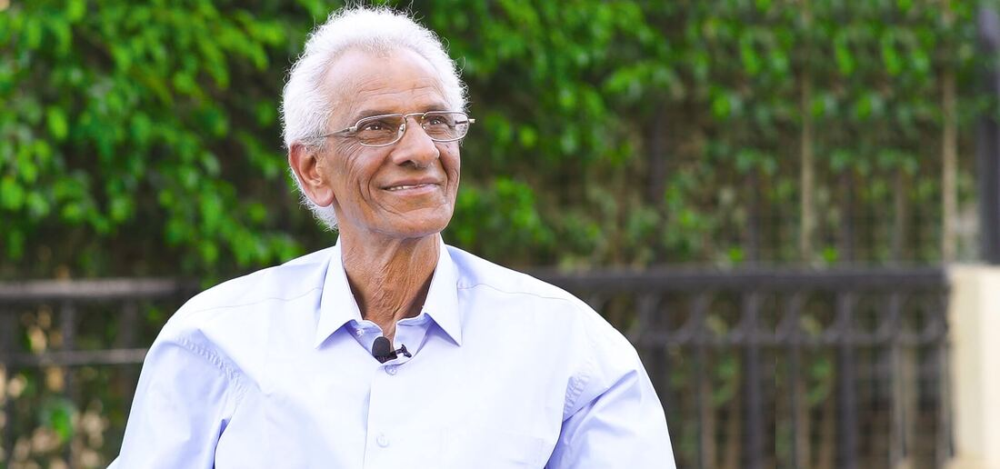

## مؤسس مدارس جينيسيس الدولية

## «حلمنا يتحقق، جينيسيس!»

## – د. سعيد ندا

لطالما آمنت بأن المدرسة ليست مجرد مكان يحصل فيه الطلاب على المعلومات أو يستعدون للامتحانات، بل هي مساحة للتعاون الحيّ وتبادل الأفكار والثقافات. فالتعليم رحلة ممتدة مدى الحياة، ولهذا حلمت دائمًا بإيجاد هذه البيئة الحيوية التي يستطيع فيها الطلاب تنمية مهاراتهم إلى أقصى حد وبلوغ أعلى إمكاناتهم.

يسعدني أن أرحّب بمتعلّمينا الجدد الذين يتطلعون إلى استكشاف المستقبل معنا. فأطفالنا أفراد مميزون، ولذلك نسعى في جينيسيس إلى رعاية نموّهم الفردي، ودعم فضولهم للاستكشاف، وفوق كل شيء أن نوفّر لهم بيئة حيوية ودافئة وآمنة تساعدهم على تحقيق أحلامهم وأهدافهم في الحياة.

مرحبًا بكم في مجتمع جينيسيس!  
 **د. سعيد ندا**

<iframe class="embed" src="https://www.youtube-nocookie.com/embed/7MRLA1-ChSg" title="YouTube video" loading="lazy" allowfullscreen></iframe>

## «في ذكرى المؤسس، د. سعيد ندا»

إن كتابة رسالة بعد رحيل شخص عزيز، كوالدي الغالي، مهمة شاقة للغاية. فقد كانت عبقرية د. سعيد ندا وشغفه وطاقته مصدرًا لخطوات لا تُحصى نحو أهداف أكاديمية وغير أكاديمية تحققت على مرّ السنين.

كان أهم ما يعنيه هو تطوير المعلّم وإثراؤه. وكان ندا من القادة التربويين القلائل الذين امتلكوا الشجاعة للتفكير بطريقة مختلفة، والجرأة على الإيمان بقدرتهم على تغيير العالم، والموهبة اللازمة لتحقيق ذلك.

لم يرَ التعليم يومًا تجارةً يكون الربح فيها غاية في ذاته؛ بل كان الربح دائمًا نتيجة طبيعية لجودة الخدمة، ودليلًا على برامج تعليمية تتحدث عن نفسها. كان حالمًا، وآمن دائمًا بأن التعليم هو العامل الأساسي في نجاح الأمم. كما آمن دائمًا بقدرات المعلمين، فدعا إلى تطويرهم، وأصرّ على أن تبدأ أي دعوة للإصلاح التعليمي بهم وإلى جانبهم.

وفي أيامه الأخيرة، تذكّر كثيرًا من طلابه، وكان متلهفًا لمعرفة قصص نجاحهم ورؤيتهم. كما تواصل مع كثير من أعضاء فريقه القدامى الذين يعملون اليوم في عدد من أكبر المدارس وأنجحها في مصر أو يديرونها. ولطالما رأى رحلته غير مكتملة، وظل حتى آخر أيامه يفكر في الخطوات والأهداف الجديدة التي أراد تحقيقها ليرى مدرسته تواصل النمو والنجاح.

ابنته الفخورة به،  
 **إنجي سعيد ندا**
