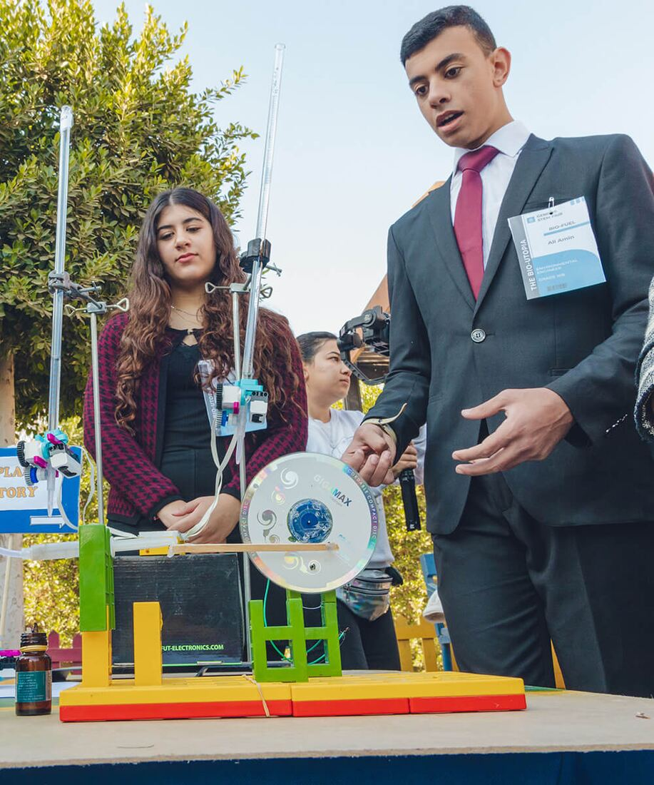
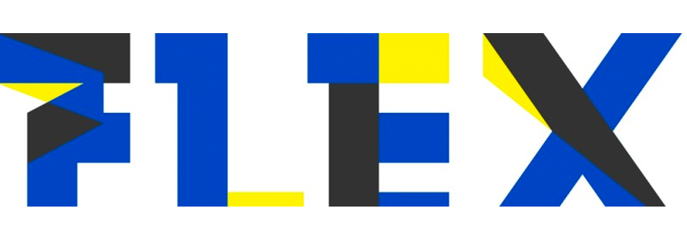

تقدّم جينيسيس مجموعة واسعة من الأنشطة اللاصفية التي تلبّي اهتمامات طلابها المتنوعة. ومن السمات المميزة للمدرسة تركيزها على تعليم STEAM، الذي يشمل أنشطة الروبوتات والبرمجة والذكاء الاصطناعي. كما تقدّم المدرسة برنامج قراءة متكاملًا يشجّع الطلاب على حبّ الأدب وتحسين مهاراتهم في القراءة. إلى جانب ذلك، توفّر المدرسة خدمات الإرشاد المهني لمساعدة الطلاب على اتخاذ قرارات واعية بشأن مستقبلهم. وتتيح جينيسيس كذلك فرص تدريب عملي تمنح الطلاب خبرة تطبيقية في المجالات التي يختارونها.

وفي مجال الأنشطة المصاحبة للمنهج، توفّر مدارس جينيسيس الدولية مجموعة من الأندية اللاصفية مثل الخطابة والمسرح وغيرهما. كما تستضيف المدرسة فعالية نموذج جينيسيس للأمم المتحدة (GMUN) التي تتيح للطلاب التعرّف على العلاقات الدولية والدبلوماسية. ويُعدّ اتحاد طلاب جينيسيس (GSU) منصة أخرى تتيح للطلاب تنمية مهاراتهم القيادية وتمثيل زملائهم.

وتقدّم المدرسة أيضًا أسابيع المسرح ثنائي اللغة، حيث يتعرّف الطلاب على لغات مختلفة ويقدّمون عروضًا بها. كما يوفّر برنامج الدعم والتقوية مساندة إضافية للطلاب الذين يحتاجون إلى مساعدة في مواد معينة. وتتيح مدارس جينيسيس الدولية للطلاب كذلك فرص ممارسة الرياضة من خلال أكاديمية جينيسيس الرياضية. وأخيرًا، تضم المدرسة أكاديمية جينيسيس التقنية التي تقدّم تدريبًا في المجالات التقنية لإعداد الطلاب لوظائف المستقبل في قطاع التكنولوجيا. ومع هذه المجموعة الواسعة من الأنشطة اللاصفية، تتاح لطلاب مدارس جينيسيس الدولية فرصة تنمية مهاراتهم ومتابعة اهتماماتهم ليصبحوا أفرادًا متكاملين.

## قاعة مشاهير جينيسيس

### اتحاد طلاب جينيسيس

اتحاد الطلاب في مدارس جينيسيس الدولية هيئة نشطة وفاعلة تعمل على تعزيز مصالح الطلاب. ويتكوّن الاتحاد من ممثلين منتخبين من الطلاب يعملون عن قرب مع إدارة المدرسة لضمان إيصال أصوات الطلاب. ويشارك أعضاء الاتحاد في مجموعة واسعة من الأنشطة، مثل تنظيم الفعاليات وإدارة الأندية الطلابية ونشر الوعي بالقضايا التي تمسّ الطلاب. ويمنح اتحاد الطلاب الطلابَ منصة لتنمية مهارات القيادة والتواصل، والتعرّف على الحوكمة وعمليات اتخاذ القرار. ومن خلال تعزيز القيادة الطلابية وتمكين الطلاب، يؤدي اتحاد الطلاب دورًا أساسيًا في إثراء تجربة الطلاب في مدارس جينيسيس الدولية.

### أكاديمية جينيسيس الرياضية (GSA)

أكاديمية جينيسيس الرياضية برنامج متكامل يتيح لطلاب مدارس جينيسيس الدولية ممارسة مجموعة من الرياضات مثل كرة القدم وكرة السلة والكاراتيه والجمباز وغيرها. وتلتزم الأكاديمية بتعزيز اللياقة البدنية وروح الفريق والروح الرياضية بين الطلاب. وقد صُمم البرنامج ليناسب احتياجات واهتمامات الطلاب من جميع الأعمار ومستويات المهارة، وتوفّر المدرسة مرافق حديثة ومدربين خبراء لضمان أفضل تدريب للطلاب. ومن خلال ممارسة الرياضة يكتسب الطلاب مهارات مهمة مثل الانضباط والمثابرة والقيادة. وتُعدّ أكاديمية جينيسيس الرياضية جزءًا أساسيًا من التزام المدرسة بتقديم تعليم متكامل يُعدّ الطلاب للنجاح في جميع مجالات الحياة.

### أكاديمية جينيسيس التقنية (GTA)

بالشراكة مع 

أكاديمية جينيسيس التقنية، بالشراكة مع FLEX، برنامج متطور يتيح لطلاب مدارس جينيسيس الدولية تعلّم الروبوتات والبرمجة وأنشطة الذكاء الاصطناعي. وقد صُممت الأكاديمية لتزويد الطلاب بالمعارف والمهارات اللازمة للنجاح في قطاع التكنولوجيا دائم التطور. ويقدّم البرنامج منهجًا شاملًا يغطي موضوعات مثل لغات البرمجة وتطوير البرمجيات وتعلّم الآلة. ويحصل الطلاب على مرافق حديثة ومدربين خبراء يرشدونهم خلال رحلة التعلّم. ومن خلال المشاركة في أكاديمية جينيسيس التقنية يكتسب الطلاب المهارات التي يحتاجونها للنجاح في بيئة العمل في القرن الحادي والعشرين. ويؤكد هذا البرنامج التزام المدرسة بتقديم تعليم مبتكر ومواكب يُعدّ الطلاب للمستقبل.

### نموذج جينيسيس للأمم المتحدة (GMUN)

نموذج جينيسيس للأمم المتحدة (GMUN) منظمة يقودها الطلاب وتهدف إلى تعزيز المواطنة العالمية والدبلوماسية بين طلاب مدارس جينيسيس الدولية. ويتيح البرنامج للطلاب المشاركة في محاكاة لجلسات الأمم المتحدة يطوّرون خلالها مهارات الخطابة والتفاوض والتفكير النقدي. ومن خلال GMUN يتعرّف الطلاب على القضايا العالمية الراهنة وعلى عمل الأمم المتحدة. وقد صُمم البرنامج لتعزيز روح التعاون بين طلاب من خلفيات متنوعة، فيوسّع آفاقهم ويمنحهم منظورًا عالميًا. ويؤكد البرنامج التزام المدرسة بتقديم تعليم شامل يُعدّ الطلاب ليكونوا مواطنين عالميين فاعلين.
