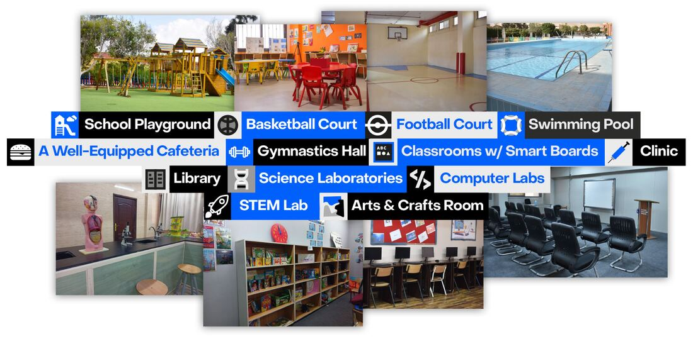
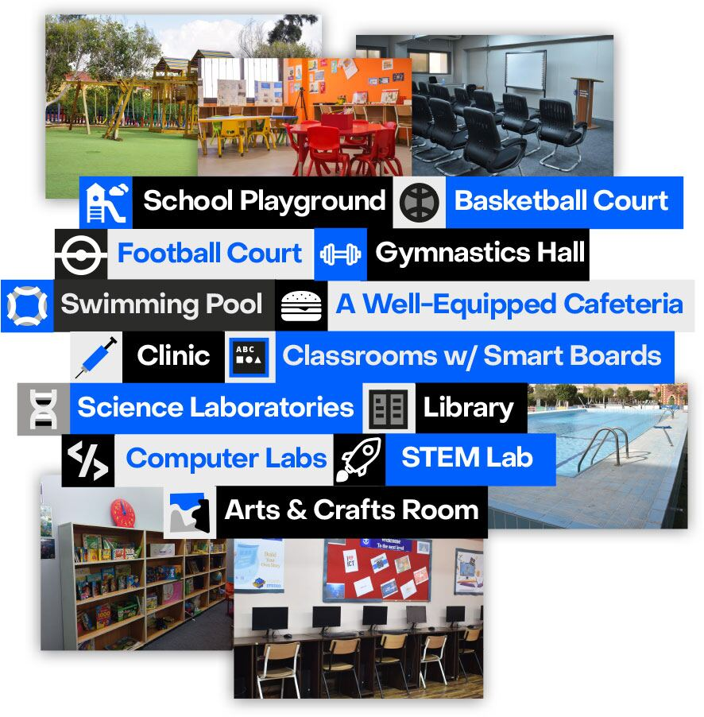

خلال السنوات الثلاث الماضية، أجرت مدرستنا تحسينات كبيرة على البنية التحتية والمرافق لرفع كفاءة العملية التعليمية. ويضم الحرم الأمريكي على وجه الخصوص مبنى من خمسة طوابق، وملعبين، وملعبًا لكرة السلة، وملعبًا لكرة القدم، وكافتيريا مجهزة جيدًا، وصالة للجمباز. ومبنى القسم الأمريكي واسع ومصمم بما يلائم أساليب التعلّم في المدرسة، إذ يضم مكاتب كافية، وفصولًا مجهزة جيدًا بسبورات ذكية، وعيادة، ومكتبتين بهما مجموعة متنوعة من الموسوعات وكتب لمؤلفين مشهورين، ومعملين للعلوم والفيزياء والكيمياء والأحياء، ومعملين للحاسب الآلي، وغرفة STEM، وغرفتين للفنون والأشغال اليدوية، وغرفتين للموسيقى، وغرفة لتدريس الاقتصاد المنزلي. كما رفعت المدرسة سرعة الإنترنت بشكل كبير للاستفادة المثلى من الموارد الرقمية والتكنولوجيا.

