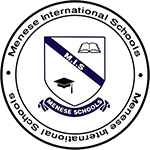
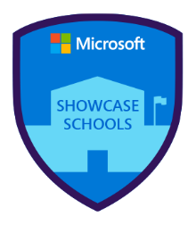
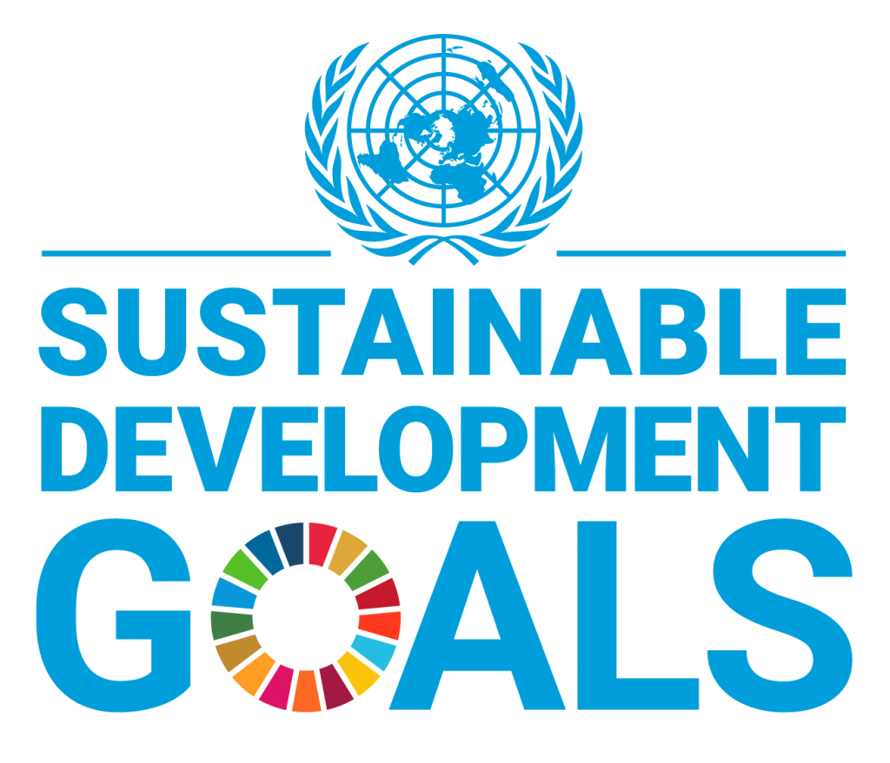
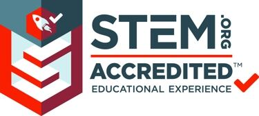
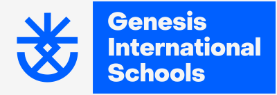
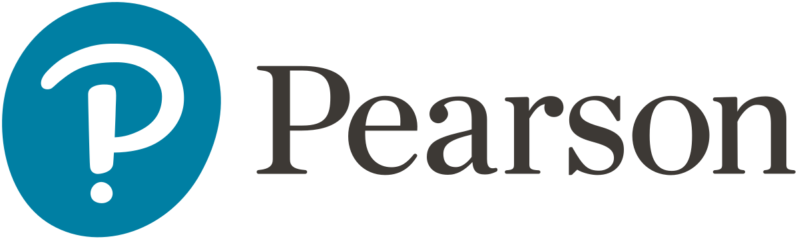
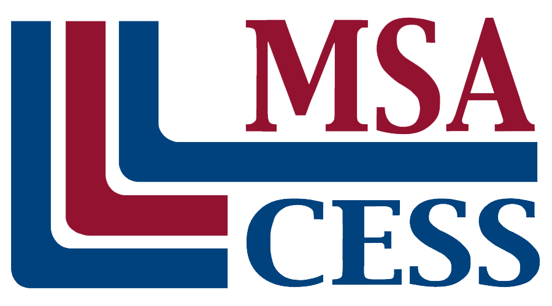
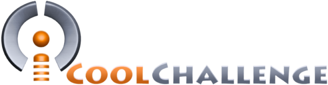

## 1992

- تأسيس مدارس مينيس الدولية

## 1998

- مدرسة معتمدة لشهادة IGCSE

## 2005

- مدرسة معتمدة من CITA وAdvancEd

## 2019

- إنجاز التحوّل الرقمي – مدرسة Microsoft Showcase
- أول مدرسة في مصر تتحوّل إلى مدرسة خضراء – إطار التنمية المستدامة (ESD)

## 2020

- مدرسة معتمدة من STEM.org
- التأهل لنهائيات جوائز GESS – سفراء البيئة

## 2021

- مينيس تصبح جينيسيس
- شهادة التميّز في الذكاء الاصطناعي

## 2022

- اعتماد من Pearson
- مرشّحة لاعتماد MSA
- التأهل في تحدي iCool لتمثيل مصر في دوريات الروبوتات لمنطقة آسيا والمحيط الهادئ

## 2023

- إعادة تفعيل الترخيص
- فوز فريق جينيسيس بجائزة All Rising Stars في مسابقة FLL (First LEGO League 2023)
- اعتماد من Oxford

