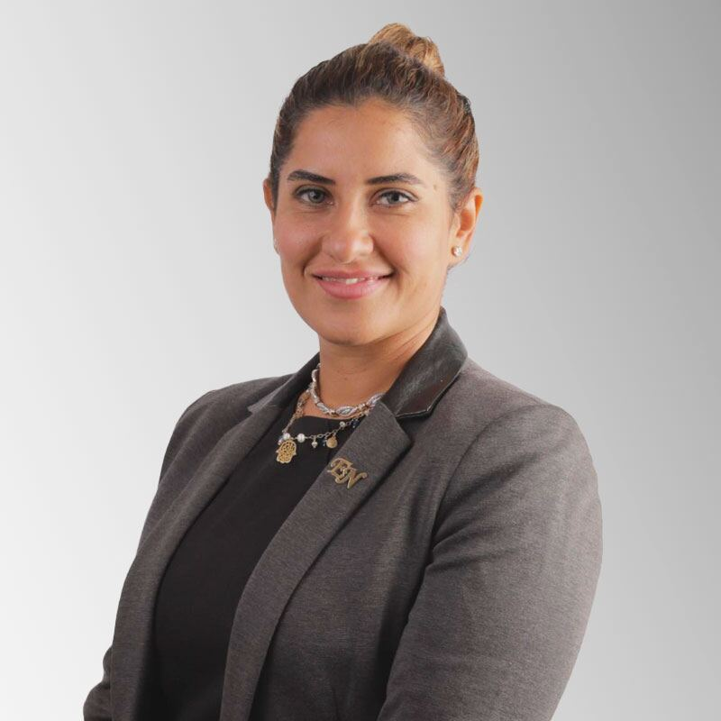
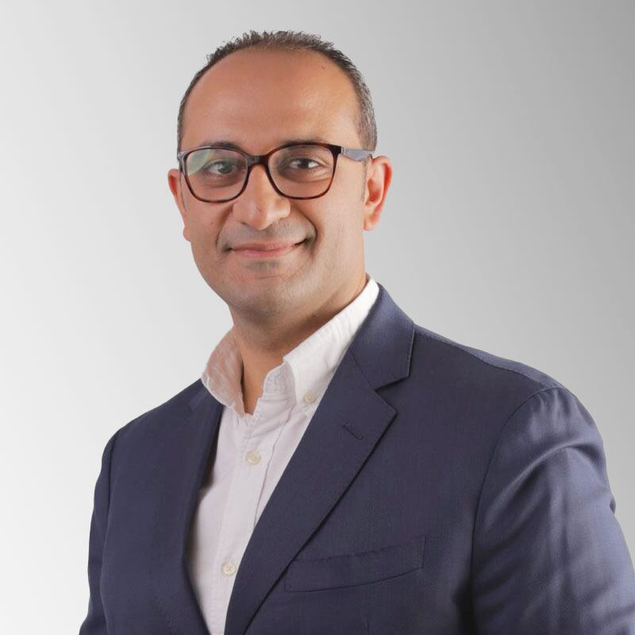
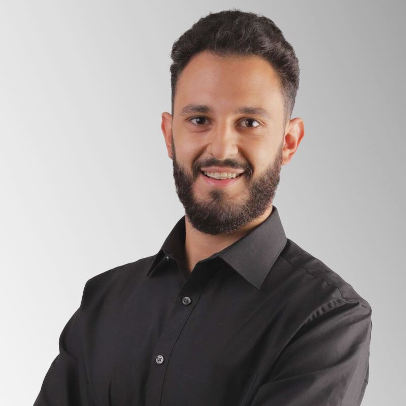
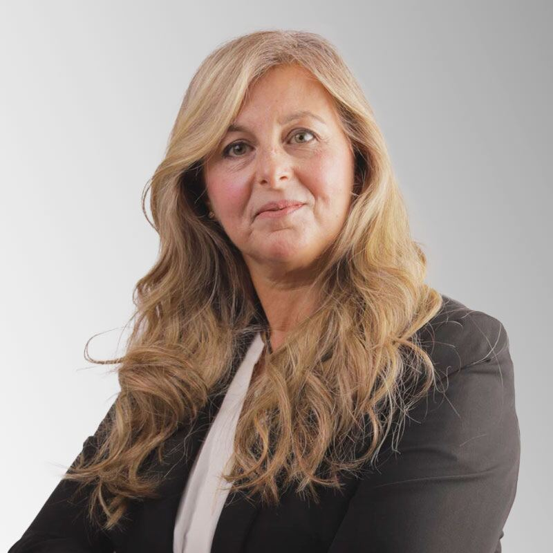
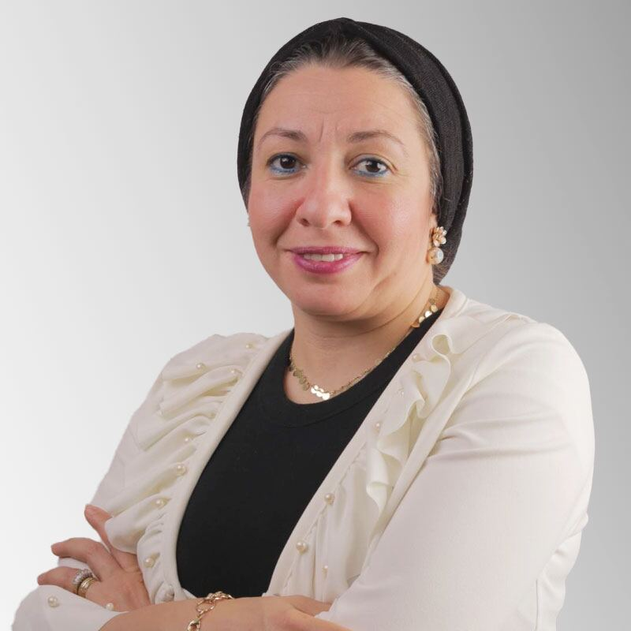
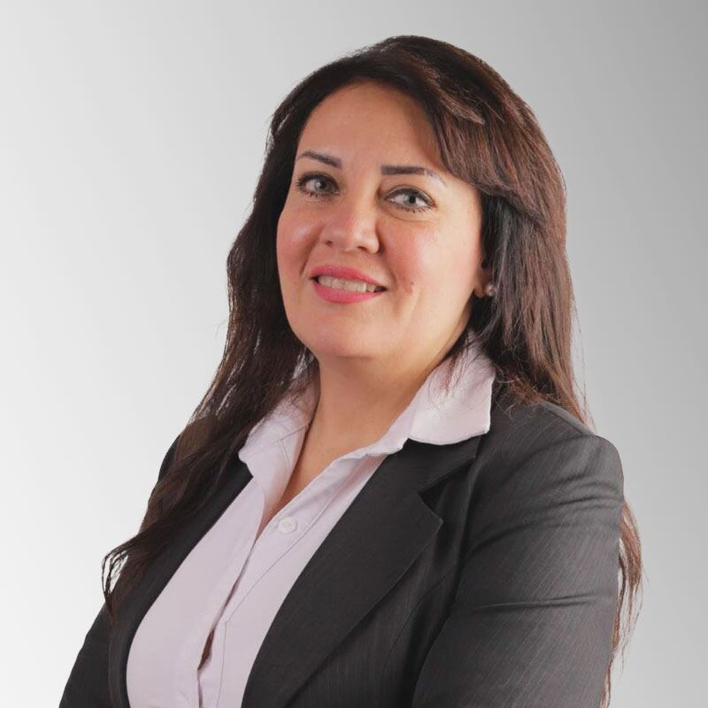
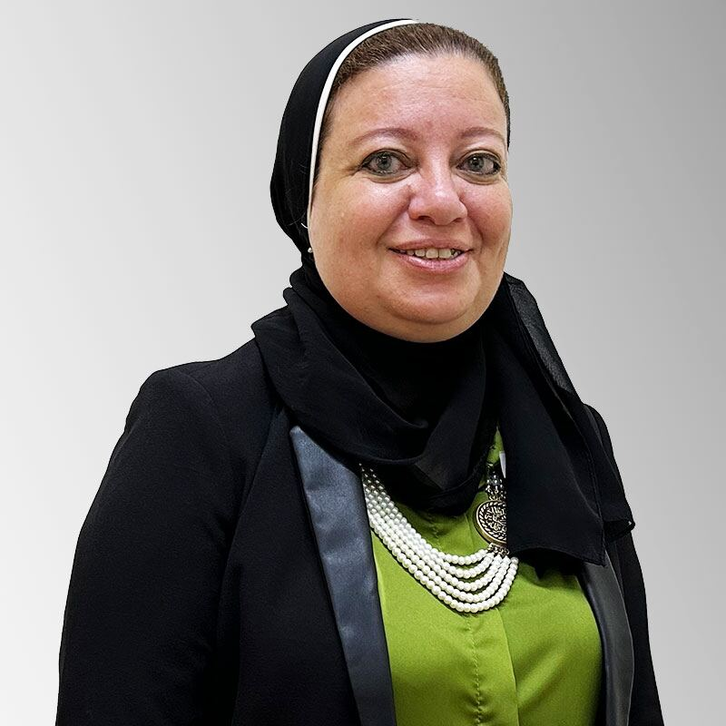
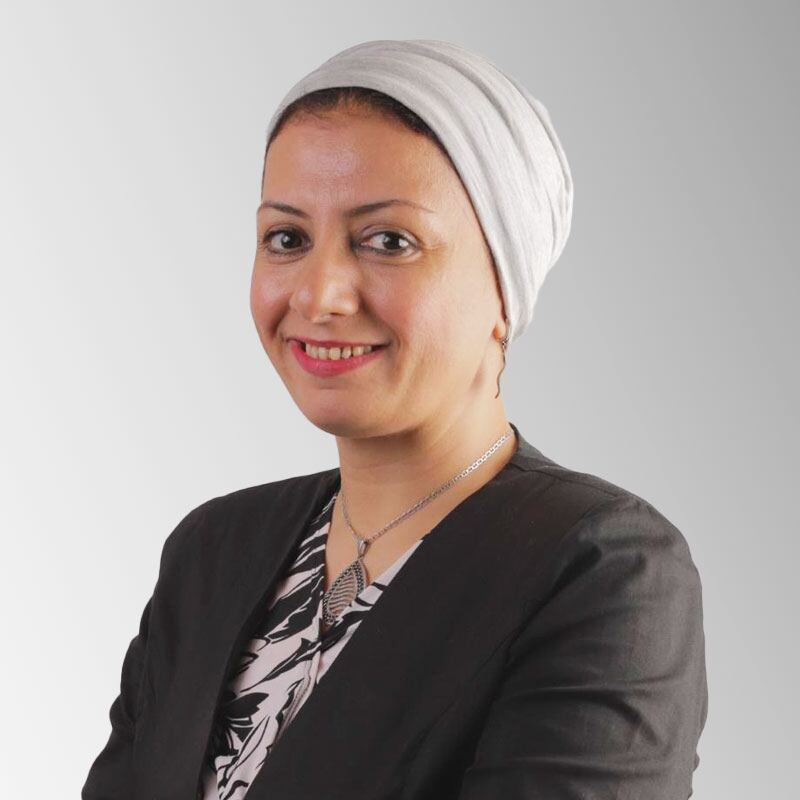
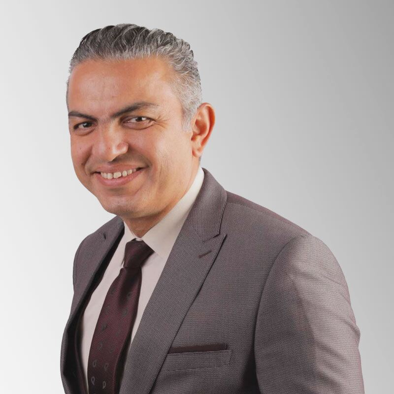
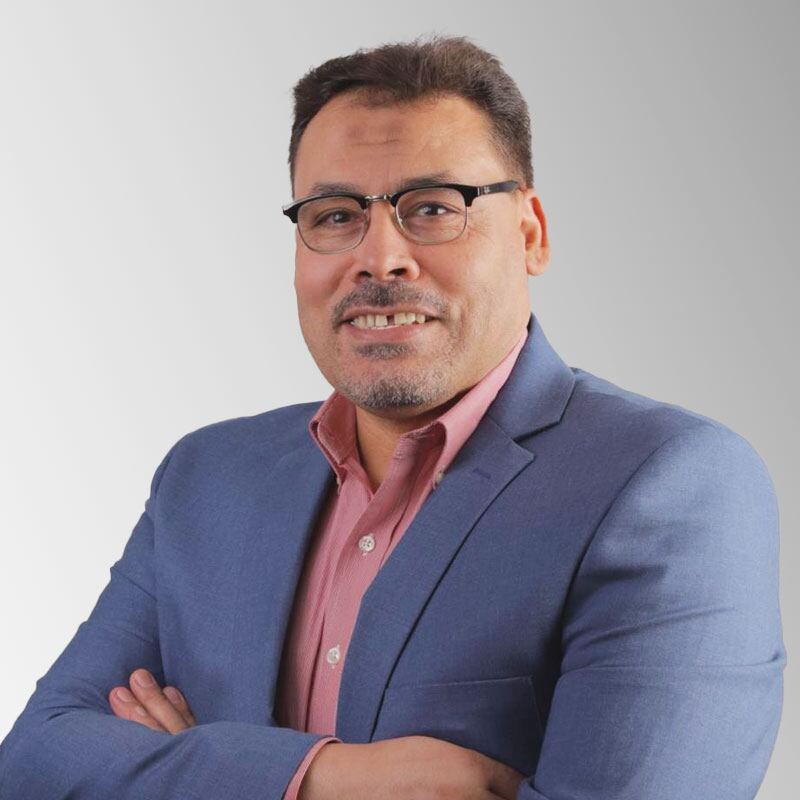

## كلمة الرئيسة التنفيذية / مديرة المدرسة

أعزائي مجتمع جينيسيس،

يسعدني كثيرًا أن أعلن عن التغييرات المميزة التي أجريناها في مدرستنا. فقد أتاحت لنا عملية تجديد هويتنا الحفاظ على قيمنا الثقافية العزيزة وتراثنا وتاريخنا وحكمتنا وولائنا وأخلاقنا، مع احتضان الجوانب الجديدة والمبتكرة من روح الشباب والإبداع والحداثة والابتكار والتجدد. فهويتنا المتجددة تلبّي تمامًا متطلبات مصر الجديدة: العريقة والأنيقة والرصينة والعظيمة والمتسارعة والمهيبة، والمفعمة في الوقت نفسه بفرص النمو والتطور.

في مدارس مينيس – جينيسيس الآن – الدولية، نفخر كثيرًا بتقديم أفضل تعليم ممكن، ودعم تعلّم طلابنا، ورعاية تجربتهم كاملة. وقد حملت السنوات الماضية تحديات غير مسبوقة بسبب جائحة كوفيد-19، لكننا ظللنا طوال الوقت ملتزمين بضمان سلامة طلابنا وأسرهم ومجتمعنا المدرسي. فجدارتنا بالثقة وشغفنا بالتعليم هما ما يجعلنا عائلة واحدة، وحبّنا المشترك هو ما يدفع مسيرتنا إلى الأمام.

ورغم تغيّر التعليم، بقينا ثابتين على التزامنا بتقديم أرقى عمل ودعم وأكثرهما ريادة. وندرك أن هناك اليوم طرقًا بديلة كثيرة لتعلّم مهارات جديدة، ونظل ملتزمين باحتضان هذه الأساليب والمنهجيات الجديدة بعقول وقلوب منفتحة. ونؤمن إيمانًا راسخًا بأنه لا مكان للخوف في المرحلة المقبلة.

ندعوكم بحرارة إلى الانضمام إلينا في هذه الرحلة الرائعة نحو النمو والتطور، واتركوا لنا تقديم أحدث مهارات القرن الحادي والعشرين وأفضلها في أفضل بيئة تعليمية.

مع خالص التحيات،  
 **إنجي سعيد ندا**  
 الرئيسة التنفيذية للتعليم / مديرة المدرسة

## مجلس إدارة مدارس جينيسيس الدولية

### مجلس الإدارة

#### السيدة إنجي ندا

الرئيسة التنفيذية / مديرة المدرسة

#### السيد أحمد ندا

المدير المالي (CFO)

#### السيد مصطفى ندا

مدير العمليات (COO)

### المدرسة شبه الدولية (Semi-International)

#### السيدة حنان رزق

مديرة مرحلة رياض الأطفال

#### السيدة نيرمين بشير

مديرة المرحلتين الابتدائية والإعدادية

### المدرستان الأمريكية والبريطانية

#### السيدة سوزان ألبرت

مديرة مرحلة رياض الأطفال

#### السيدة رشا موسى

مديرة المرحلة الابتدائية

#### د. عزة عفت

ناظرة المدرسة البريطانية

#### د. وليد فتحي

مدير المرحلتين المتوسطة والثانوية

### مستشار

#### د. محمد علي

مستشار STEM
