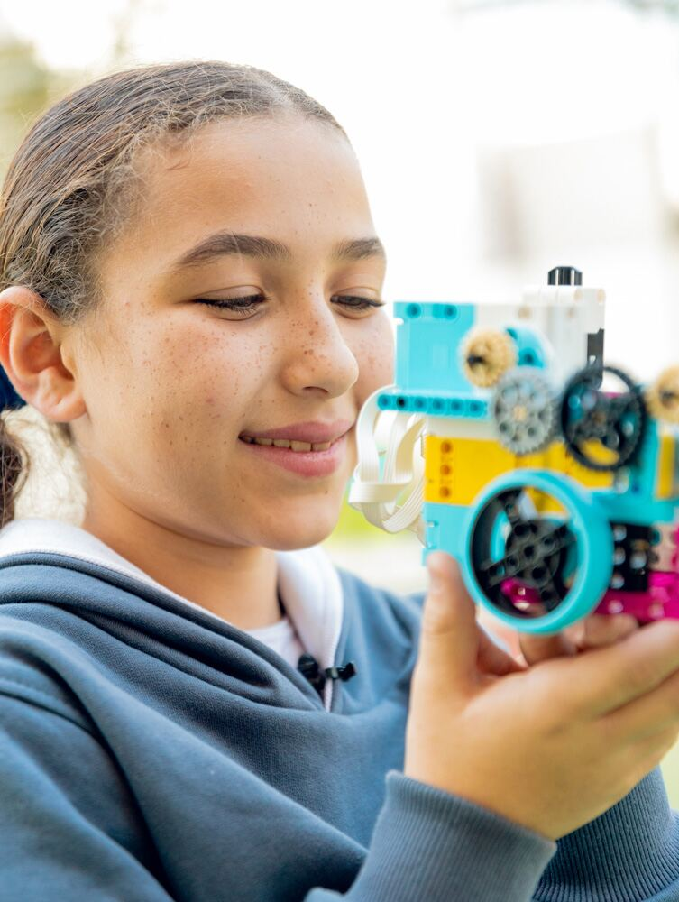
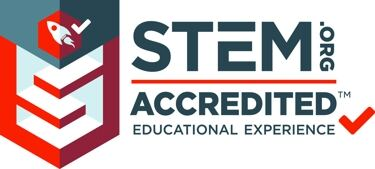
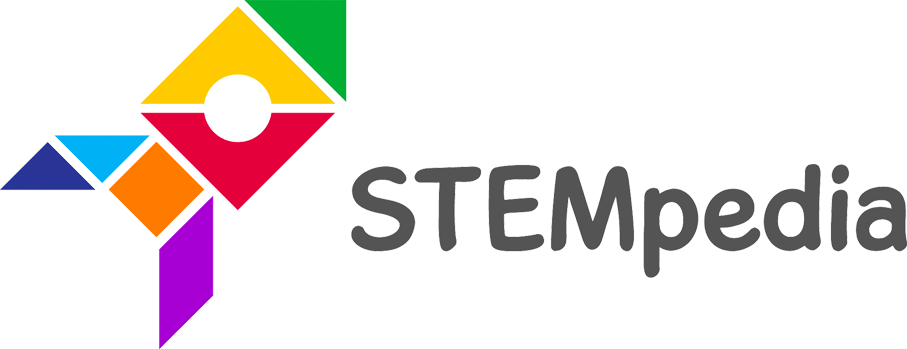
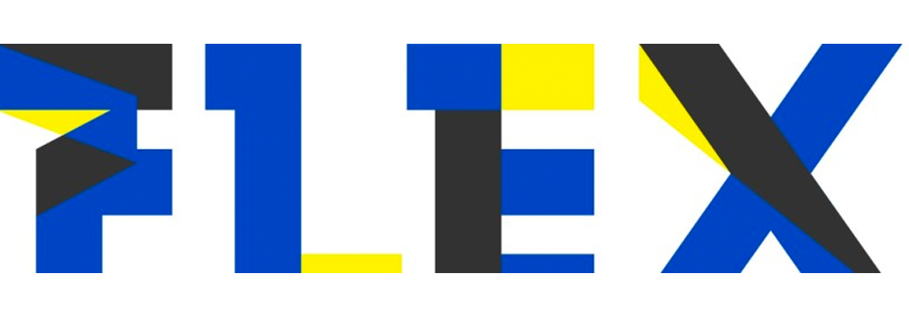
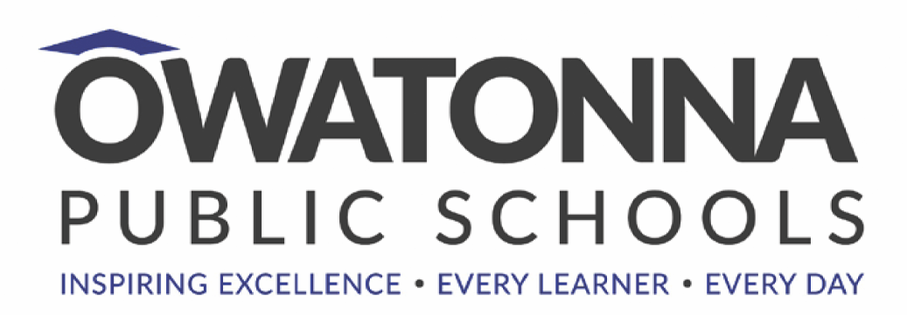

رسّخت مدارس جينيسيس الدولية سمعتها في التميّز الأكاديمي، ومن أهم العوامل التي أسهمت في ذلك برنامج STEM. فمنذ إطلاقه في العام الدراسي 2018-2019، طُبّق STEM بوصفه نهجًا متكاملًا يقوم على الدمج بين تخصصات مختلفة، منها العلوم والرياضيات وفنون اللغة وتكنولوجيا المعلومات والاتصالات. وقد ساعد هذا النهج الطلاب على تكوين فهم أشمل للمادة العلمية، وهو أمر ضروري في عالم اليوم دائم التطور.

يتيح STEAM للطلاب الربط بين المفاهيم عبر المواد والمواقف المختلفة. والنتيجة طلاب يخوضون مخاطرات مدروسة، وينخرطون في التعلّم بالتجربة، ويثابرون في حلّ المشكلات، ويرحّبون بالتعاون، ويعملون عبر العملية الإبداعية. وباختصار، يصنع STEAM متعلّمين مدى الحياة مؤهلين لمتطلبات القرن الحادي والعشرين.

## عن البرنامج

من الطرق التي قاست بها المدرسة نجاح برنامج STEM تشجيع طلابها على المشاركة في المسابقات الخارجية. فعلى سبيل المثال، حققت المدرسة نجاحًا كبيرًا في مسابقة «Microsoft Climate Initiative to save the world in 2019 / CLIMATE CHANGE PROJECT»، حيث عمل الطلاب معًا لابتكار حلول لمواجهة تغيّر المناخ. كما شاركت المدرسة في مسابقات معارض العلوم التي تُنظَّم بين مدارس القاهرة، وفي معرض Microsoft Innovative Educator في باريس عام 2019.

وعلى مرّ السنين، شهد برنامج STEM في مدارس جينيسيس الدولية تطورًا لافتًا. فما بدأ نهجًا متكاملًا أصبح اليوم برنامجًا متكاملًا قائمًا على المعايير، ويدعمه معلمون أصحاب رؤية. وقد بذلت المدرسة جهدًا إضافيًا لضمان الجودة بحصولها على اعتماد STEM.ORG، وهو إنجاز يؤكد التزامها بتقديم أفضل تعليم ممكن لطلابها.

وفي العام الدراسي 2021-2022، ارتقت مدارس جينيسيس الدولية ببرنامج STEM إلى مستوى جديد؛ إذ أصبح البرنامج أكثر تنظيمًا وقائمًا على البيانات، مع تركيز خاص على دمج الروبوتات. ولضمان توافق المنهج مع أهداف المدرسة، طُبّقت عملية كاملة لمواءمة المناهج. كما دُرّب المعلمون على تقديم المنهج بطريقة تجذب الطلاب وتعمّق فهمهم للمادة، وطُبّقت متابعة للتقدّم لضمان تقدّم الطلاب ومعالجة أي مشكلات فورًا.

وختامًا، حققت مدارس جينيسيس الدولية خطوات كبيرة في تعزيز تعليم STEM. ومع ذلك تدرك المدرسة أن هناك المزيد لضمان امتلاك طلابها المعارف والمهارات اللازمة للنجاح في القرن الحادي والعشرين، وهي ملتزمة بمواصلة الابتكار وتطوير برنامج STEM لتقديم أفضل تعليم ممكن لطلابها.

## اعتمادات STEM والشركاء

