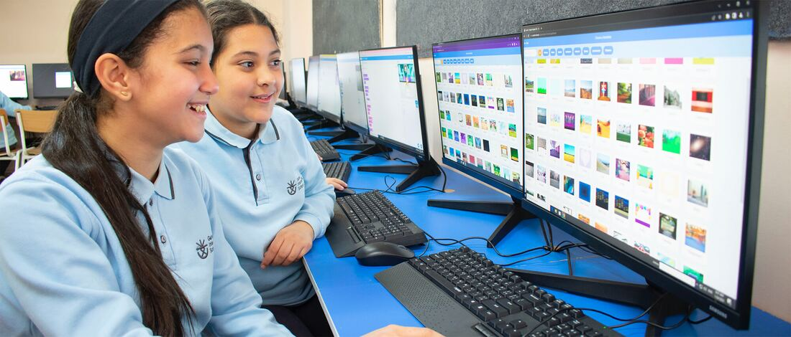
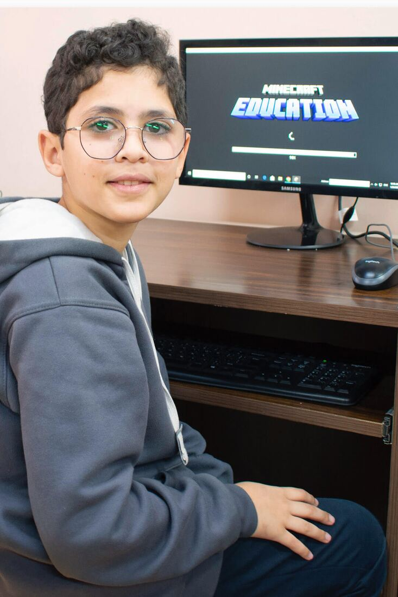
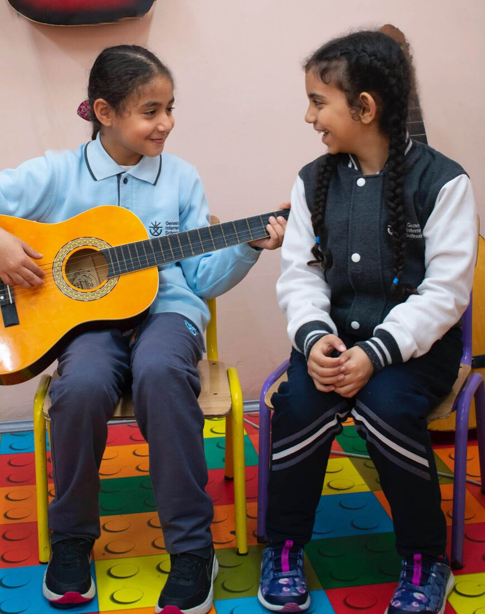
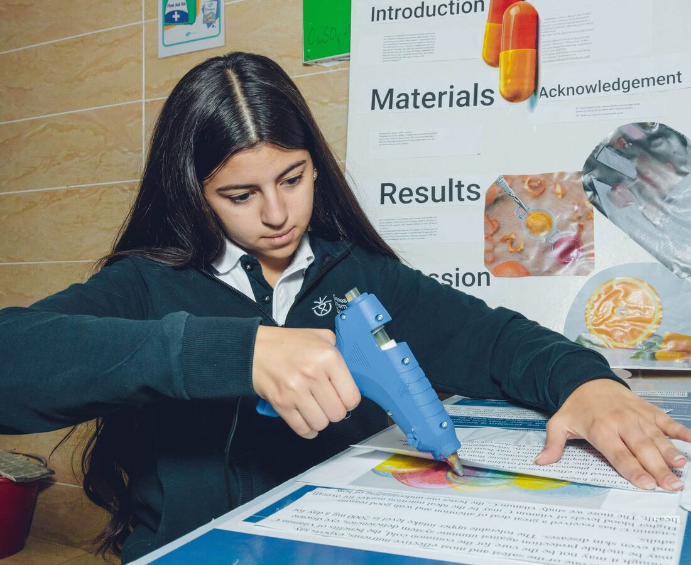

## لماذا نفخر بمنهجنا الدراسي؟

تولي مدرستنا اهتمامًا كبيرًا بتقديم تعليم عالي الجودة، ولذلك فإن تصميم خطط مناهج تتوافق مع رؤيتنا ورسالتنا يأتي على رأس أولوياتنا. ويتميز منهجنا بما يلي:

- قائم على معايير دولية مثل CCSS وNEXT GENERATION وCEFR.
- متّسق رأسيًا وأفقيًا لضمان تقدّم منتظم في التعلّم.
- مدعوم بمصادر تعليمية غنية بالمعلومات.
- يخضع للمتابعة والمراجعة المنتظمة لإجراء التعديلات اللازمة.
- يتضمن استراتيجيات تدريس تتمحور حول الطالب.
- يقدّمه معلمون ذوو كفاءة عالية.

## مقررات التنسيب المتقدم (AP)

ضمن منهج المرحلة الثانوية، نقدّم مجموعة متنوعة من مقررات التنسيب المتقدم (AP) لإعداد الطلاب للنجاح في الجامعة وفي حياتهم المهنية. ويمكن لهذه المقررات أن ترفع المعدل التراكمي للطلاب، وقد تؤهلهم للحصول على منح دراسية قائمة على التفوق ومنح من الجامعات. ومن خلال دراسة مقررات AP يعزّز الطلاب فرصهم في التعليم العالي.

## البرامج الأكاديمية في جينيسيس

تتنوّع برامجنا الأكاديمية لتلبّي الاحتياجات المختلفة لطلابنا، ومنها:

- تعليم STEAM
- أنشطة الروبوتات والبرمجة والذكاء الاصطناعي
- برنامج القراءة
- الإرشاد المهني
- فرص التدريب العملي
- الأنشطة المصاحبة للمنهج

- أندية لاصفية مثل الخطابة والمسرح وغيرهما
- GMUN (نموذج جينيسيس للأمم المتحدة)
- GSU (اتحاد طلاب جينيسيس)
- أسابيع المسرح ثنائي اللغة
- برنامج الدعم والتقوية

## نهج فريد في التعليم الأكاديمي

## التعليم من أجل التنمية المستدامة (ESD)

يوفّر التعليم من أجل التنمية المستدامة فرصًا تعليمية متميزة تُنشئ أفرادًا مسؤولين قادرين على تشكيل العالم وصناعة المستقبل. ويتضمن منهج ESD ما يلي:

- منهج شامل ومتعدد التخصصات.
- محتوى جذاب ومحفّز يمكن تحليله ومناقشته وتقييمه وتطبيقه.
- أساليب متعددة لاكتساب المهارات وتطبيقها.
- تجارب تعلّم قائمة على حلّ مشكلات من الواقع.
- سياقات ذات صلة وقريبة من الطلاب، محليًا وعالميًا.
- فرص للمشاركة الفعالة في عمليات اتخاذ القرار.

## مهارات القرن الحادي والعشرين (CLD)

يركّز إطار تصميم التعلّم لمهارات القرن الحادي والعشرين (CLD) على العناصر الأساسية التالية في جميع أنشطة التعلّم:

- التعاون وتقاسم المسؤولية
- التمكين لاتخاذ قرارات واعية
- العمل المترابط والمتكامل
- البناء النشط للمعرفة
- التطبيق العملي للمعرفة
- دمج تكنولوجيا المعلومات والاتصالات (ICT)
- التنظيم الذاتي والمسؤولية الشخصية
- مهارات التواصل الفعّال
- نقل المعرفة والقدرة على حلّ مشكلات الواقع وتعزيز الابتكار.
