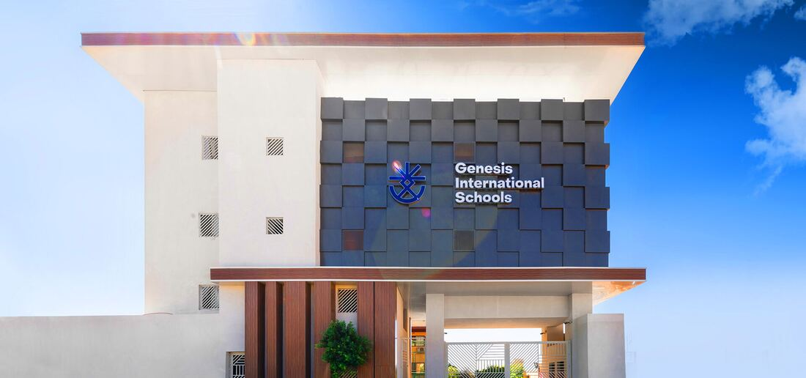

## From Menese to Genesis

Menese International Schools was founded in 1990 with the goal of providing a high-quality education to students, emphasizing equity and distinction. The school has since built a reputation for excellence and is now considered one of the most reputable educational institutions in the country. The long history of Menese has given it a legacy of experience and expertise, making it a well-respected name in the education community.

Genesis has inherited this legacy, carrying with it over 30 years of experience and high expectations. The philosophy of education at Genesis is centered around the idea of creating unique individuals who have the potential to lead fulfilling and happy lives. This is achieved through the application of enriched educational programs and activities, which are designed to help students reach their full potential and develop a love of learning.

Genesis is committed to providing students with an education that is both rigorous and engaging. The school’s faculty and staff are dedicated to helping students grow and develop, both academically and personally. Whether it is through hands-on learning experiences, challenging coursework, or extracurricular activities, Genesis provides its students with a wealth of opportunities to explore their interests and develop their skills.

At Genesis, the focus is on helping students become well-rounded individuals who are equipped to succeed in whatever path they choose. Whether it is in college, the workforce, or in their personal lives, the education that students receive at Genesis provides a foundation for success that will stay with them for a lifetime. The goal is to create individuals who are confident, knowledgeable, and capable, and who are equipped to make a positive impact on the world.

## Mission & Vision

### Mission

To provide a sustainable learning environment by utilizing today’s technological advancements, whilst leading to superior task performance and professional growth in the educational field.

### Vision

To enable self-discovery and to develop the core values and aptitudes of life-long learners in a global and sustainable environment while keeping true to the identity and heritage of the institution.

## Genesis Schools’ Values

### Transformable Leadership

‘Through inspiration, a new generation is created’ By providing successful leadership values by examples and sharing their resources; Genesis works on shaping a new community of leaders, risk takers and success stories.

### Social Responsibility

Genesis applies the sustainable development tools provided by the UN (United Nations) to help foster our community of thinkers through innovation, integrity and individuality.

### Continuous Excellence

As encouragement is an important doctor in any community, we applaud our students and teacher’s achievements on both educational and extracurricular activities.

### Collaboration

To provide an enriched and ever-growing environment for our students, teachers and parents; Genesis collaborates with the latest educational tools.

### Edutainment

We strongly believe that education should always include a fun element. This method ensures that both the student and the teacher alike are enjoying and learning the topic taught and helps provide a creative and forward learning experience.

## Portrait of a Genesis Graduate

At Genesis International Schools, we prepare our graduates to thrive in a rapidly changing global landscape. The Genesis Graduate embodies academic excellence, ethical leadership, global citizenship, and well-being. Our students emerge as confident, future-ready learners equipped with the skills, values, and mindsets needed to lead meaningful lives and contribute to a just, sustainable world.

**Genesis International Schools develops graduates who are:**

### I. Academically Competent and Curious Learners

Genesis students:

- Demonstrate mastery in core academic disciplines (Math, Science, English, Social Studies, and Second Language (French or German)) aligned with international standards (Common Core, NGSS, CEFR, and AP Standards)
- Apply critical thinking, research, and problem-solving across subjects
- Are proficient in at least three languages: Arabic, English, and either German or French, with English as the primary medium of instruction.
- Use digital tools and emerging technologies ethically and effectively
- Are accepted to prestigious universities such as **AUC, GUC, GIU, BUE, EUE, and ASU**, pursuing programs in **engineering, medicine, pharmacy, law, computer science, political science, and psychology**
- Some earn **merit-based scholarships** due to academic achievement and **leadership portfolios**

### II. 21st Century Thinkers and Innovators

Genesis graduates:

- Master 21st-century skills: critical thinking, creativity, communication, and collaboration
- Are entrepreneurial, solution-focused, and adaptable to change
- Participate in coding, robotics, science fairs, and design-based challenges
- Use innovation to solve real-world problems, focusing on areas such as health and well-being, quality education, and environmental sustainability.

### III. Global Citizens with a Purpose

Genesis graduates:

- Embrace diversity, cultural awareness, and respect for others
- Understand and support the United Nations Sustainable Development Goals (SDGs) through school projects and service learning
- Participate in global programs such as Model United Nations (GMUN) and international exchanges
- Promote justice, environmental responsibility, and equity in local and global contexts

### IV. Socially-Emotionally Aware and Well-Being Literate

Genesis graduates:

- Develop emotional intelligence, self-awareness, and resilience through the Leader in Me curriculum, based on Stephen Covey’s 7 Habits
- Cultivate physical, mental, and emotional well-being through alignment with the CASTLE Framework for SEL
- Demonstrate leadership in service, academics, and student voice through platforms like the Genesis Student Union (GSU)
- Exhibit confidence, accountability, and intrinsic motivation in all learning settings.
- Demonstrate genuine empathy by actively engaging in charity events and community service initiatives.
- Engage meaningfully in charitable work and act as role models for younger students by guiding and encouraging them to participate in community service efforts.

### V. Innovative & Future-Ready

Genesis students:

- Engage in STEM and STEAM disciplines through inquiry-based learning
- Participate in robotics, coding, and design thinking challenges
- Demonstrate creativity, entrepreneurship, and adaptability in solving real-world problems
- Are digitally literate and prepared for higher education or global careers

### V. Lifelong Learners and Reflective Thinkers

Genesis students:

- Set personal goals and self-assess their growth
- Seek feedback and view challenges as learning opportunities
- Engage in inquiry, reflection, and self-directed learning
- Show curiosity and commitment to continuous improvement

### VI. Ethical Leaders with Integrity and Initiative

Genesis graduates:

- Live by the school’s core values of respect, responsibility, and excellence
- Are proactive, purposeful, and principled decision-makers
- Lead by example, mentor others, and contribute to a positive school culture
- Build strong leadership portfolios that support scholarship, university admissions, and professional growth

### VII. Well-Rounded Individuals: Creative, Active, and Expressive

Genesis graduates:

- Participate actively in sports, arts, theater, music, and cultural events
- Display teamwork, sportsmanship, and perseverance in programs like the Gen Academy
- Express themselves creatively through visual arts, bilingual theatre, and public speaking
- Demonstrate a healthy balance between academics, personal interests, and community engagement

### VIII. Lifelong Learners with Purpose and Growth Mindsets

Genesis graduates:

- Set personal goals, track progress, and reflect regularly on their learning journey
- Seek constructive feedback and use challenges as growth opportunities
- Stay curious, self-directed, and future-focused
- Continue to learn, adapt, and contribute beyond graduation
