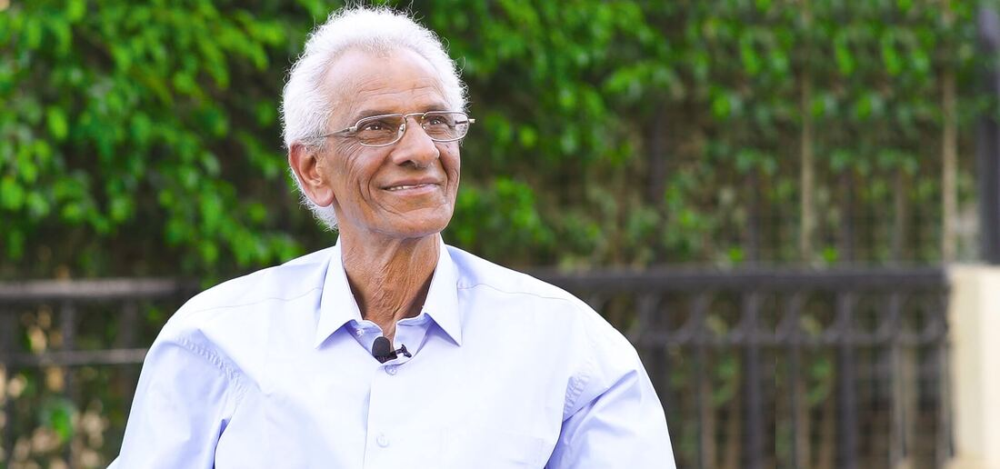

## Founder of Genesis International Schools

## “Our dream is becoming a reality, Genesis!”

## – Dr. Saeed Nada

I always had a strong belief that a school should not only be a place where students get information or study for their exams; it is rather a place of dynamic collaboration to exchange thoughts and cultures. Education is life-long process; this is why I have always dreamt of creating this dynamic environment, where students can maximize their skills and reach their highest potentials.

With pleasure, I welcome our new learners, who strive to explore the future with us. Our children are special individuals; therefore, at Genesis we aim to develop their individual growth, support their curiosity to explore, and- above all- offer them a lively, caring, and safe environment to help them achieve their dreams and goals in life.

Welcome to Genesis Community! 
 **Dr. Saeed Nada**

<iframe class="embed" src="https://www.youtube-nocookie.com/embed/7MRLA1-ChSg" title="YouTube video" loading="lazy" allowfullscreen></iframe>

## “In memory of the founder, Dr. Saeed Nada”

Writing a message after the passing of someone, like my dearest father, is a very hard job. Dr. Saeed Nada’s brilliance, passion, and energy were the source of countless steps towards various academic and none-academic goals that were accomplished throughout the years.

To him, the most important aspect that really mattered was the development and enrichment of an educators. Nada was among the few educational leaders brave enough to think differently, bold enough to believe he could change the world, and talented enough to do it.

Schooling was never seen as a business where profit should stand for itself; however, profit was always a by-product that followed the quality of the service and proved the educational programs that stand for themselves. He was a dreamer and always believed in the fact that education is the main variable of success for a nation. He always believed in the capacity of the teachers, where he called for their development and insisted on always beginning with them in their corner whenever there is a call for educational reform.

During his last days, he recalled many of his students and was anxious to know about their success stories and get to see them. Moreover, he contacted a lot of his old team members that are currently working for or running a number of the largest and most successful schools in Egypt. He has always seen his journey as an incomplete one and till his last day, he thought about the new steps and goals that he wanted to fulfill to always see his school growing successfully.

His Proud Daughter, 
 **Engy Saeed Nada**
