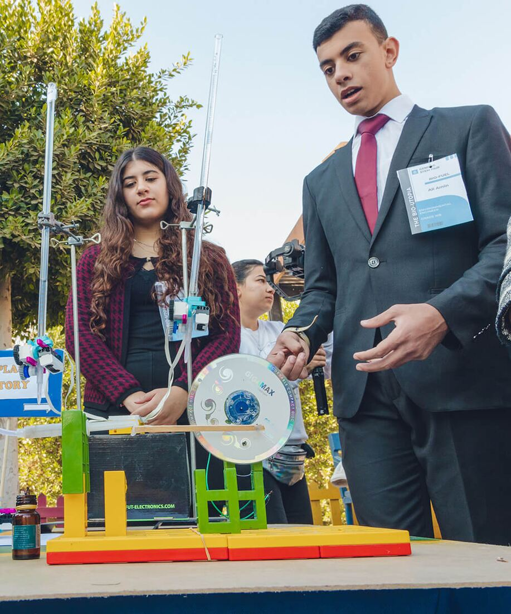
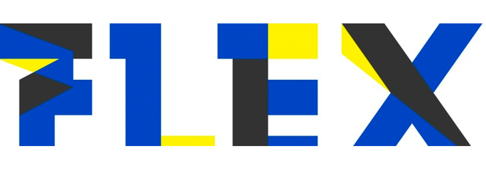

Genesis offers a wide range of extra-curricular activities that cater to the diverse interests of its students. One of the unique features of the school is its emphasis on STEAM education, which includes robotics, coding, and AI-based activities. The school also has a comprehensive reading program that encourages students to develop a love for literature and improve their reading skills. Additionally, the school provides career counseling services to help students make informed decisions about their future. Besides, Genesis offers internship opportunities that give students the chance to gain practical experience in their chosen field.

In terms of co-curricular activities, Genesis International Schools provides a range of extracurricular clubs such as public speaking, drama, and more. The school also hosts a Genesis Model United Nations (GMUN) event that enables students to learn about international relations and diplomacy. The Genesis Student Union (GSU) is another platform that allows students to develop their leadership skills and represent their peers.

The school also offers bilingual drama weeks, where students can learn about and perform in different languages. Additionally, the school has a remedial program that provides additional support to students who require extra help in certain subjects. Genesis International Schools also provides opportunities for students to participate in sports through its Genesis Sports Academy. Finally, the school has a Genesis Tech Academy that provides training in technology-related fields to help prepare students for future careers in the tech industry. With such a wide range of extra-curricular activities available, students at Genesis International Schools have the opportunity to develop their skills, pursue their interests, and become well-rounded individuals.

## Genesis Hall of Fame

### Genesis Students' Union

The Students Union at Genesis International Schools is an active and engaged body that works to promote the interests of the student body. The union is comprised of elected student representatives who work closely with school administrators to ensure that students’ voices are heard. The union members engage in a wide range of activities such as organizing events, managing student clubs, and raising awareness on various issues that affect the student body. The Students Union provides students with a platform to develop leadership skills, communication skills, and learn about governance and decision-making processes. By fostering student leadership and empowerment, the Students Union at Genesis International Schools plays an essential role in enhancing the overall student experience.

### Genesis Sports Academy (GSA)

The Genesis Sports Academy is a comprehensive program that offers students at Genesis International Schools the opportunity to participate in a range of sports such as football, basketball, karate, gymnastics, and more. The Academy is committed to promoting physical fitness, teamwork, and sportsmanship among students. The program is designed to cater to the needs and interests of students of all ages and skill levels. The school provides state-of-the-art facilities and expert coaching to ensure that students receive top-notch training. By participating in sports, students develop important skills such as discipline, perseverance, and leadership. The Genesis Sports Academy is an integral part of the school’s commitment to providing a well-rounded education that prepares students for success in all areas of life.

### Genesis Tech Academy (GTA)

Powered by 

The Genesis Tech Academy, powered FLEX, is a cutting-edge program that offers students at Genesis International Schools the opportunity to learn about Robotics, coding, and AI-based activities. The academy is designed to provide students with the knowledge and skills necessary to thrive in the ever-evolving tech industry. The program offers a comprehensive curriculum that covers various topics such as programming languages, software development, and machine learning. Students have access to state-of-the-art facilities and expert instructors who guide them through the learning process. By participating in the Genesis Tech Academy, students are equipped with the skills they need to succeed in the 21st century workplace. This program is a testament to the school’s commitment to providing innovative and relevant education that prepares students for the future.

### Genesis Model United Nations (GMUN)

The Genesis Model United Nations (GMUN) is a student-led organization that aims to promote global citizenship and diplomacy among students at Genesis International Schools. The program provides students with the opportunity to participate in mock United Nations simulations where they can develop their public speaking, negotiation, and critical thinking skills. Through GMUN, students learn about current global issues and become familiar with the work of the United Nations. The program is designed to foster a spirit of collaboration and cooperation among students from diverse backgrounds. By participating in GMUN, students are able to expand their horizons and develop a global perspective. The program is a testament to the school’s commitment to providing a holistic education that prepares students to be engaged global citizens.
