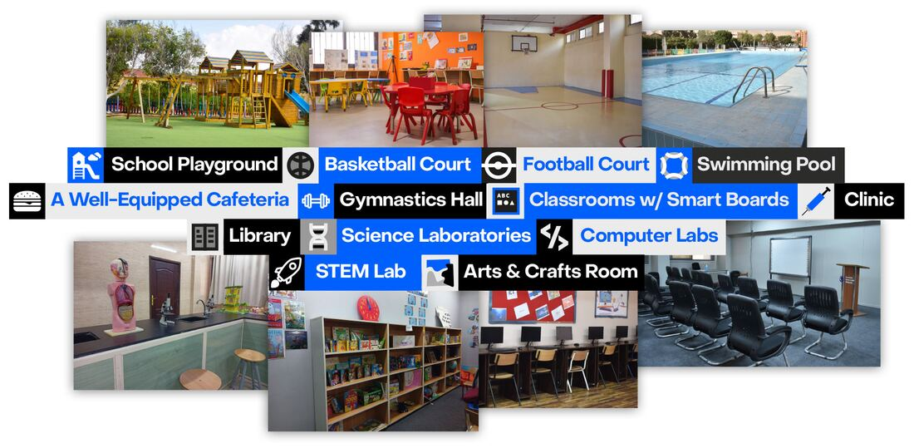
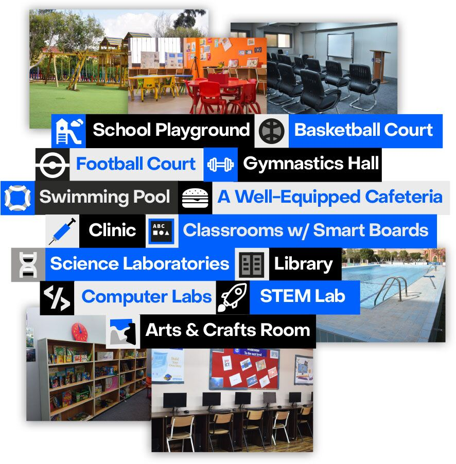

In the past three years, our school has made significant improvements to the infrastructure and facilities to enhance the efficiency of the learning process. In particular, the American campus boasts a five-story building, two playgrounds, a basketball court, a football court, a well-equipped cafeteria, and a gymnastics hall. The American Division building is spacious and tailored to meet the school’s learning practices, featuring ample offices, well-appointed classrooms with smart boards, a clinic, two libraries with a diverse range of encyclopedias and books from renowned authors, two laboratories for science, physics, chemistry, and biology, two computer labs, one STEM room, two art and craft rooms, two music rooms, and one home economics instruction room. Additionally, the school has significantly increased internet speed to optimize the use of digital resources and technology.

