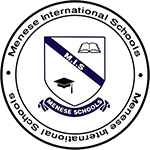
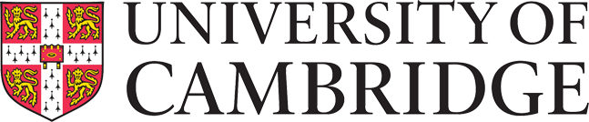
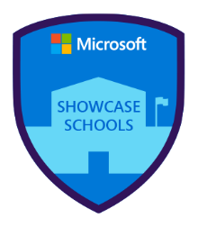
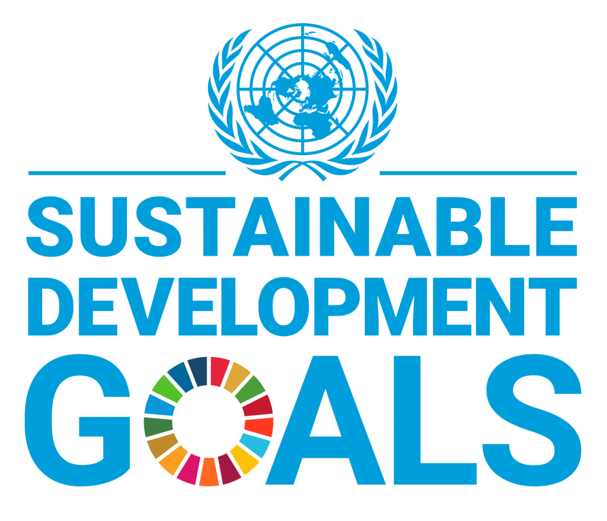
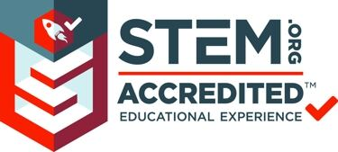
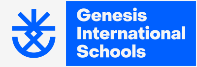
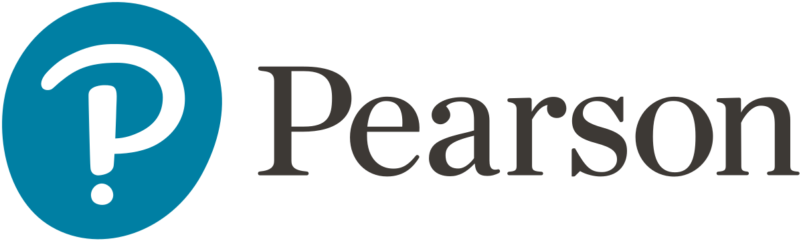
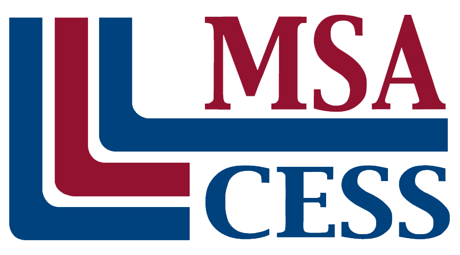
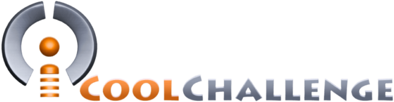

## 1992

- Foundation of Menese International Schools

## 1998

- IGCSE Certified School

## 2005

- CITA, AdvancEd Certified School

## 2019

- Digital Transformation Accomplishment - Showcase School
- The First School in Egypt to Go Green - Sustainable Development Framework. (ESD)

## 2020

- STEM.org Accredited School
- GESS Finalist - Ambassadors for the Environment

## 2021

- Menese Becomes Genesis
- Certificate of Excellence in AI

## 2022

- Certified by Pearson
- MSA Candidate
- Qualified in iCool Challenge to represent Egypt in Robotics Asia-Pacific Leagues

## 2023

- License Reactivation
- Genesis Team won the All Rising Stars Award in the FLL (First LEGO League 2023)
- Certified by Oxford

