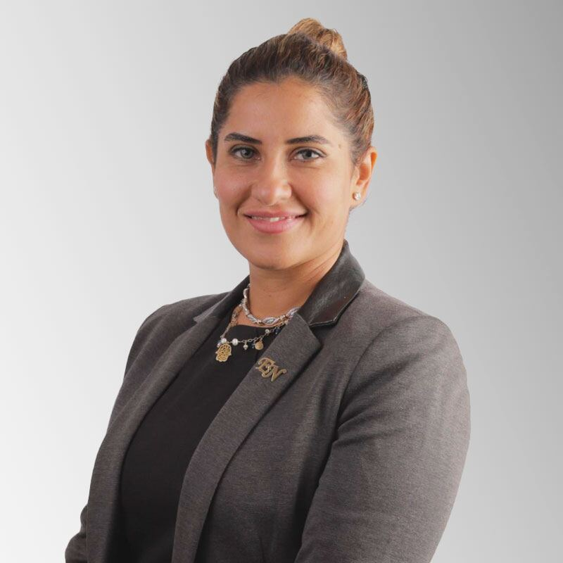
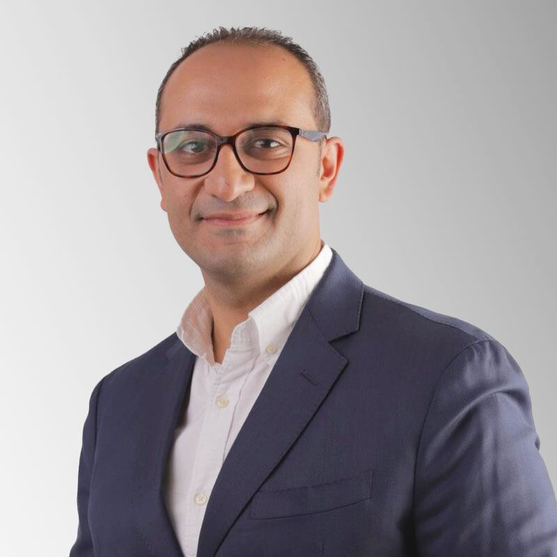
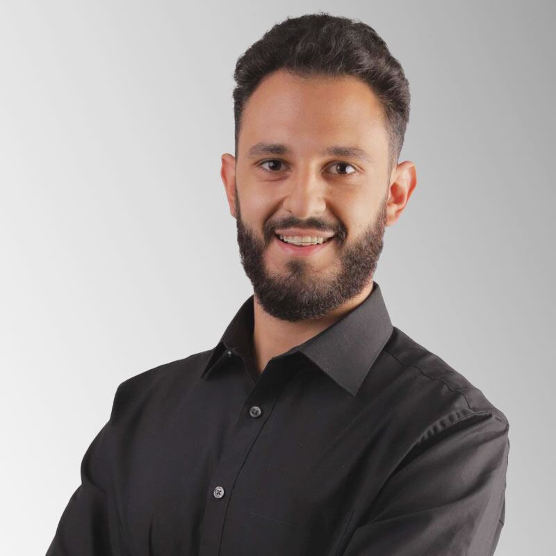
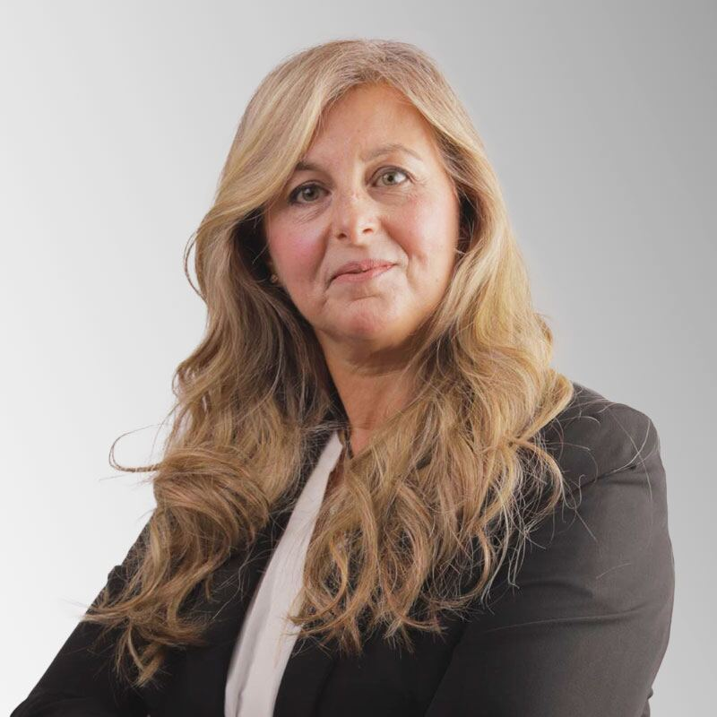
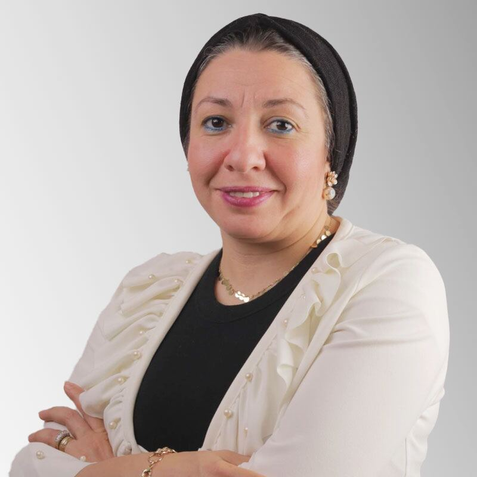
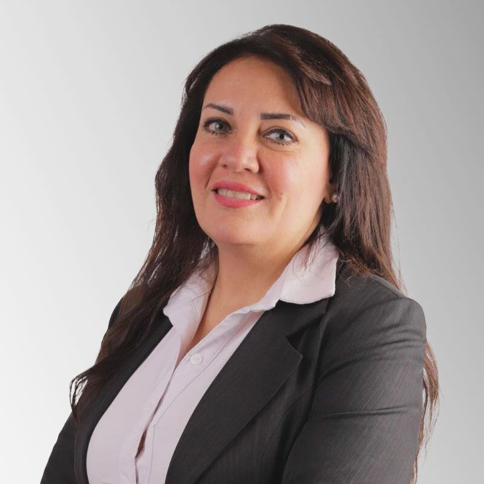
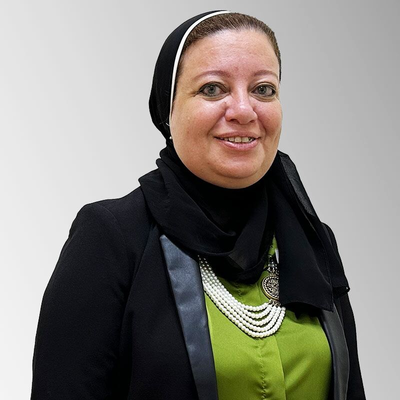
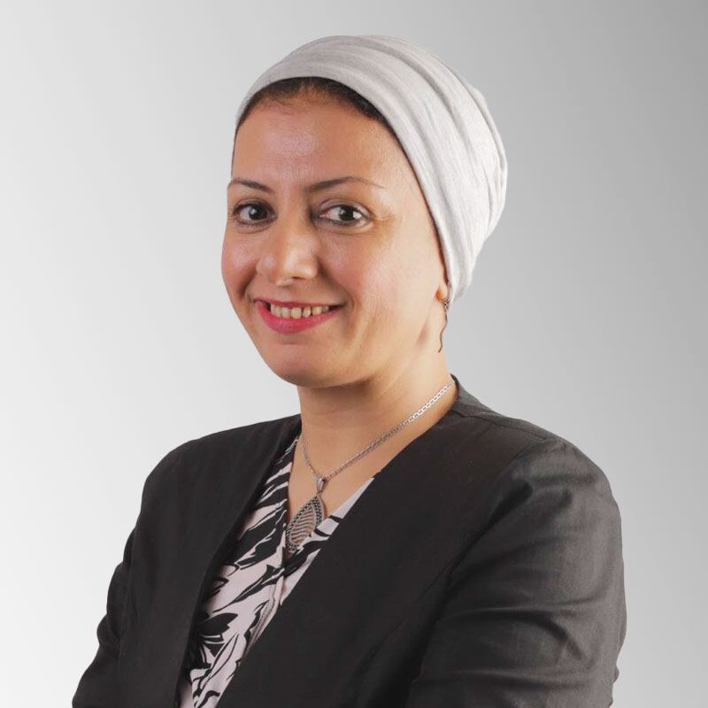
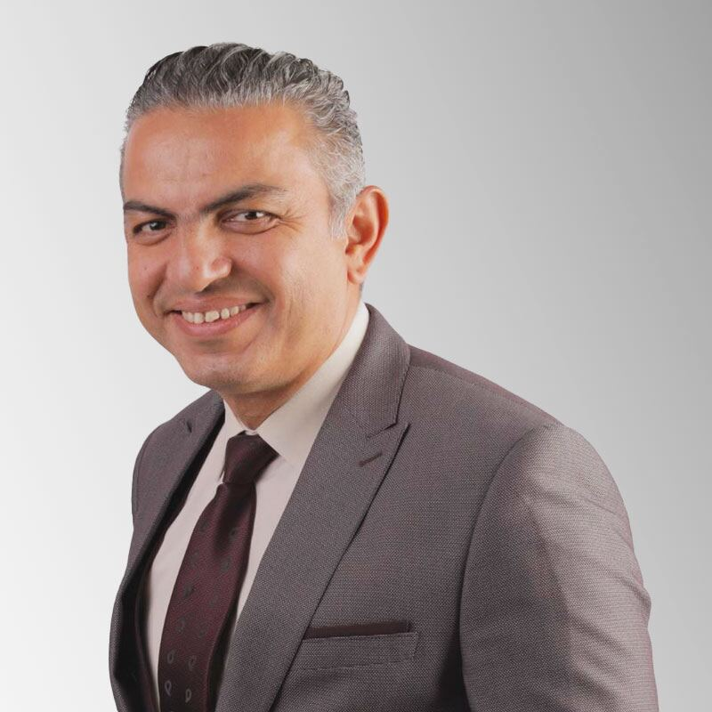
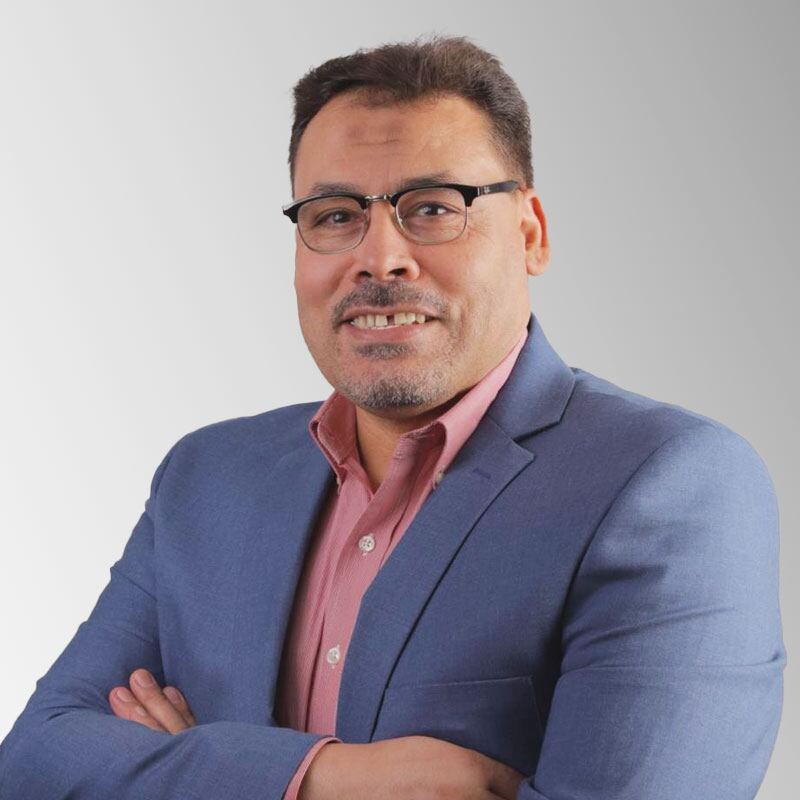

## Word of the CEO / Principal

Dear Genesis Community,

It brings me immense joy to announce the exciting changes we’ve made at our school. Our rebranding process has allowed us to preserve our treasured cultural values, heritage, history, wisdom, loyalty, and ethics, while also embracing the new and innovative aspects of youth, creativity, modernity, ingenuity, and freshness. Our renewed version is perfectly suited to meet the demands of a new Egypt that is ancient, chic, solemn, magnificent, instant, and venerable, yet brimming with potential for growth and development.

At Menese-Now Genesis-International Schools, we take immense pride in providing the best education possible, supporting our students’ learning, and nurturing their overall experience. The past couple of years have brought unimaginable challenges due to the COVID-19 pandemic, but through it all, we have remained committed to ensuring the well-being of our students, their families, and our campus community. Our trustworthiness and passion for teaching are what makes us a family, and it’s our shared love that fuels our journey forward.

Although education has changed, we have remained steadfast in our commitment to deliver the finest and leading work and support. We recognize that there are now many alternative ways to learn new skills, and we remain committed to embracing these new approaches and methodologies of learning with open minds and hearts. In the coming era, we firmly believe that fear has no place.

We warmly invite you to join us on this incredible journey towards growth and development. Leave it to us to offer you the most updated and optimal 21st-century skills in the best educational hub.

Yours, 
 **Engy Saeed Nada** 
 Chief Educational Officer / Principal

## Genesis International Schools Board

### Board of Directors

#### Mrs. Engy Nada

CEO / Principal

#### Mr. Ahmed Nada

CFO

#### Mr. Mostafa Nada

COO

### Semi-International School

#### Mrs. Hanan Rizk

KG Principal

#### Mrs. Nermine Bachir

Primary and Prep. Principal

### American and British School

#### Mrs. Susan Albert

KG Principal

#### Mrs. Rasha Mousa

Elementary Principal

#### Dr. Azza Effat

British Headmistress

#### Dr. Waleed Fathy

Middle and High School Principal

### Consultant

#### Dr. Mohammed Ali

STEM Consultant
