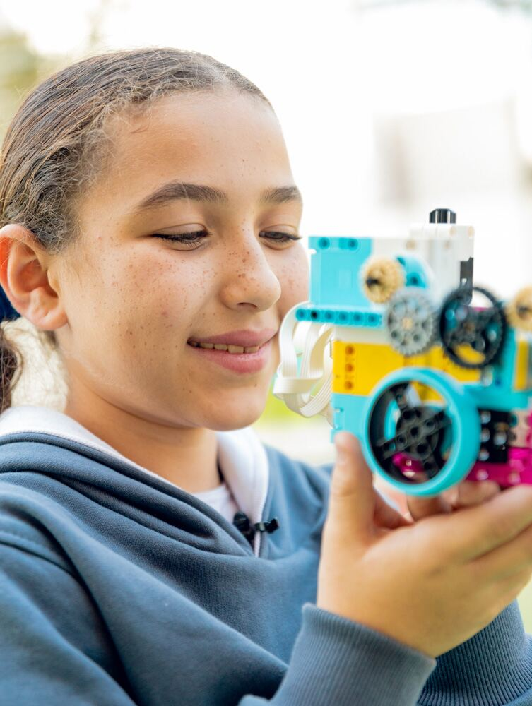
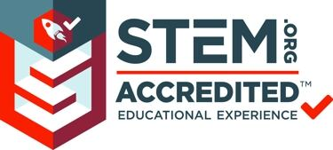
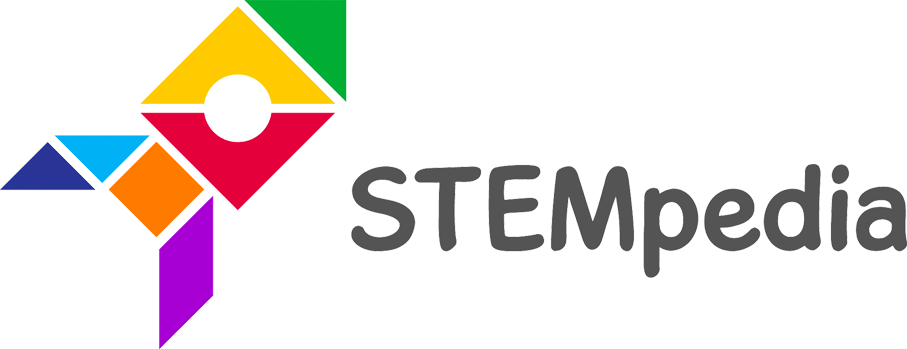
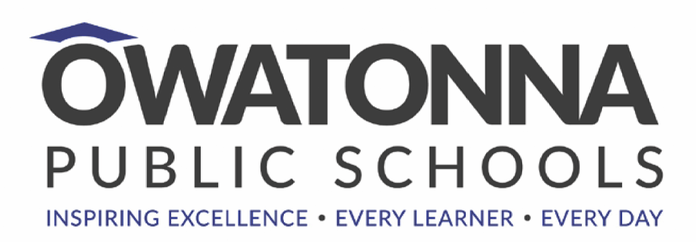

Genesis International Schools has established a reputation for academic excellence, and one of the key factors contributing to this is its STEM program. Since its launch in the 2018-2019 academic year, STEM has been implemented as an integrated approach that requires the integration of different disciplines, including science, math, language arts, and ICT. This approach has helped students develop a more comprehensive understanding of the subject matter, which is essential in today’s ever-evolving world.

STEAM enables students to relate and connect concepts across subjects and situations. The end results are students who take thoughtful risks, engage in experiential learning, persist in problem-solving, embrace collaboration, and work through the creative process. In a nutshell, STEAM creates life-long learners who are eligible for the 21st century requirements.

## About the Program

One of the ways that the school has measured the success of its STEM program is by encouraging its students to participate in external competitions. For example, the school has had great success in the “Microsoft Climate Initiative to save the world in 2019 /CLIMATE CHANGE PROJECT” competition, where students worked together to develop innovative solutions to address climate change. In addition, the school has participated in Science Fair Competitions organized among different schools in Cairo, as well as the Microsoft Innovative Educator Fair in Paris 2019.

Over the years, the STEM program at Genesis International Schools has seen remarkable progression. What started as an integrated approach has now become a full-fledged program, led by standards, and supported by visionary educators. The school has gone the extra mile to ensure quality by getting accredited by STEM.ORG, an achievement that demonstrates the school’s commitment to providing its students with the best education possible.

In the 2021-2022 academic year, Genesis International Schools has taken the STEM program to the next level. The program has become more structured and data-led, with a particular focus on robotics integration. To ensure that the curriculum is aligned with the school’s objectives, a complete process of curriculum alignment has been put in place. Additionally, teachers have been trained to deliver the curriculum in a way that engages students and enhances their understanding of the subject matter. Progress monitoring has also been applied to ensure that students are making progress and that any issues are addressed promptly.

In conclusion, Genesis International Schools has made significant strides in promoting STEM education. However, the school recognizes that there is still more to be done to ensure that its students are equipped with the knowledge and skills necessary to succeed in the 21st century. The school is committed to continuing to innovate and enhance its STEM program to provide its students with the best possible education.

## STEM Accreditations & Partners

