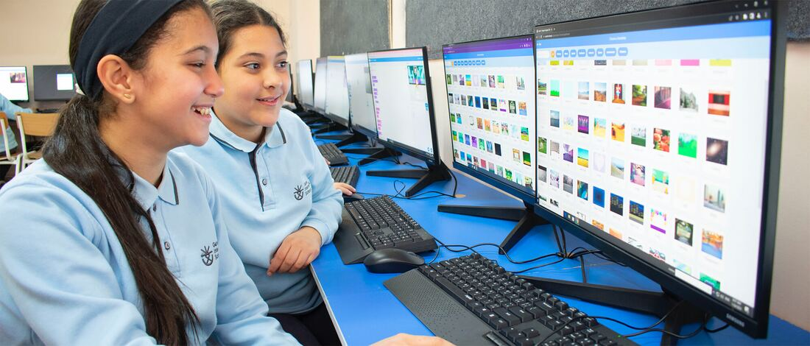
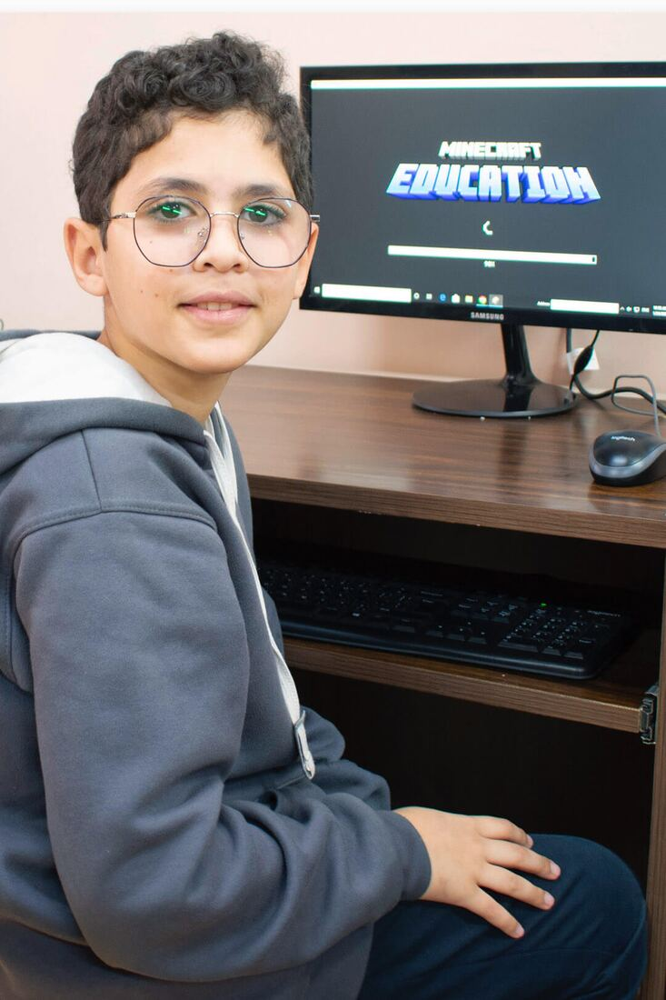
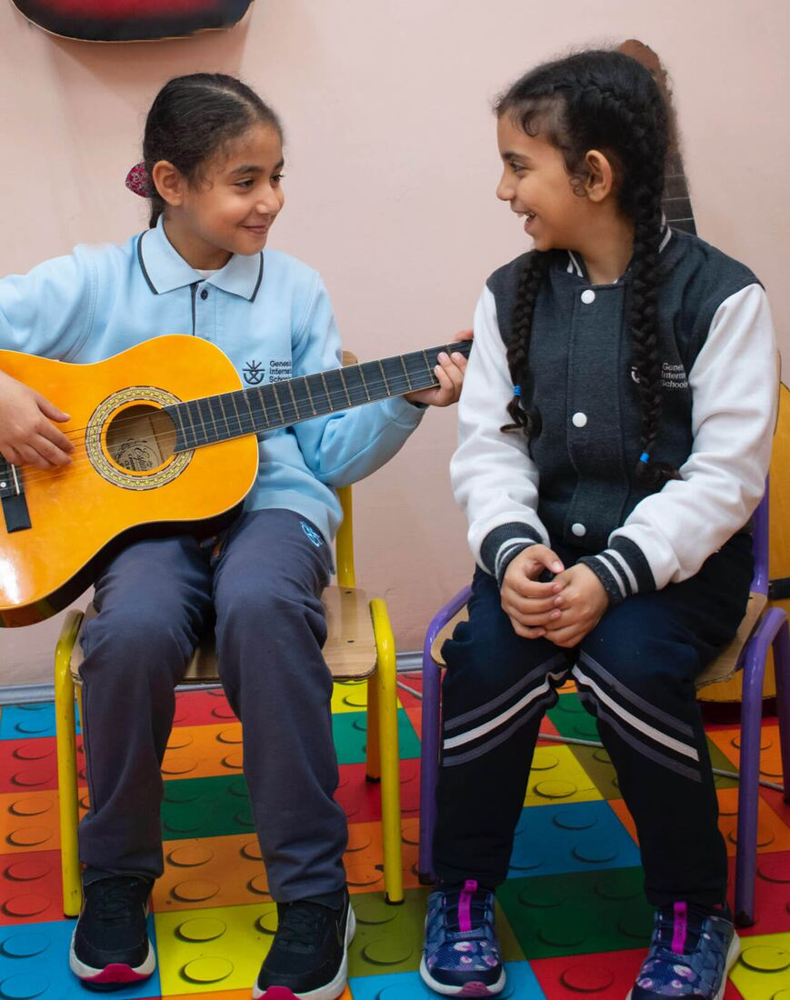
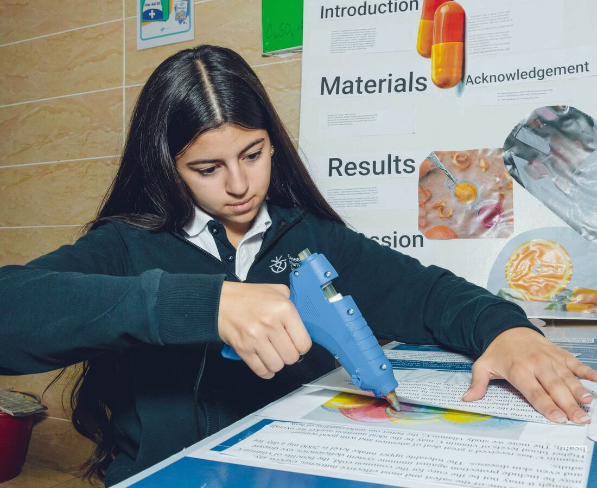

## Why do we take pride in our curriculum?

Our school places a high emphasis on providing quality education and as such, designing curriculum plans that align with our vision and mission is a top priority. Our curriculum is characterized by the following features:

- Being based on international standards such as CCSS, NEXT GENERATION, and CEFR.
- Being vertically and horizontally aligned for consistent learning progress.
- Being supported by informative resources.
- Regularly being monitored and reviewed for adjustments and modifications.
- Incorporating student-focused teaching strategies.
- Being taught by highly qualified instructors.

## Advanced Placement Courses

As part of our high school curriculum, we offer a variety of Advanced Placement (AP) courses to prepare students for college and career success. These AP classes can potentially increase students’ grade point averages and may also make them eligible for merit-based scholarships and grants from colleges. By taking AP courses, students can enhance their opportunities for higher education.

## Genesis Academics

Our academic programs are diverse and cater to the diverse needs of our students, including:

- STEAM Education
- Robotics, coding, and AI-based activities
- Reading Program
- Career Counseling
- Internship opportunities
- Co-Curricular Activities

- Extracurricular clubs such as public speaking, drama, etc.
- GMUN (Genesis Model United Nations)
- GSU (Genesis Student Union)
- Bilingual Drama Weeks
- Remedial Program

## A Unique Approach to Academia

## Education for Sustainable Development ESD

ESD provides outstanding educational opportunities that cultivate responsible individuals who are equipped to shape the world and shape the future. The curriculum of ESD includes:

- A comprehensive, interdisciplinary curriculum.
- Engaging and stimulating content that can be analyzed, discussed, evaluated and applied.
- Multiple approaches to acquire and apply skills.
- Real-world problem-based learning experiences.
- Relevant and relatable contexts- both local and global.
- Opportunities for active participation in decision-making processes.

## 21st Century Skills (CLD)

The 21st Century Skills Learning Design (CLD) framework emphasizes the following key elements in all learning activities:

- Collaboration and shared responsibility
- Empowerment for informed decision-making
- Interdependent and interconnected work
- Active construction of knowledge
- Hands-on application of knowledge
- Integration of information and communication technology (ICT)
- Self-regulation and personal accountability
- Effective communication skills
- Knowledge transfer and the ability to solve real-world problems and foster innovation.
