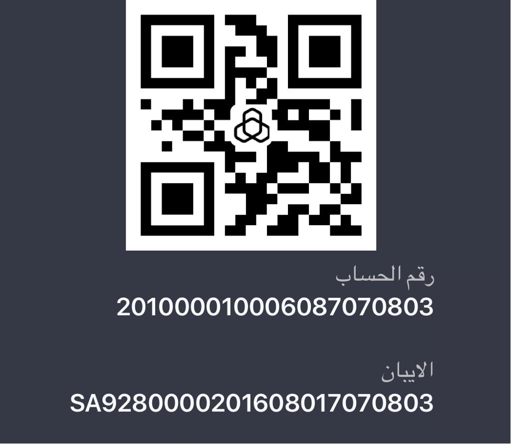

## Application Form For Entry (2025-2026)

### Apply Online

<a class="btn btn--primary" href="edusync:admission">Apply - تقدم</a>

**عزيزي ولي الأمر** 
**سيصل لك عبر البريد الإلكتروني نسخة من الاستمارة مع المرفقات الرجاء تحميلها والتوقيع عليها وارسالها على رقم الواتس المرفق** **[00966556072392](https://wa.me/966556072392)**

**Dear guardian** 
**You will receive a copy of the form with the attachments via e-mail. Please download it, sign it and send it to the attached WhatsApp number [00966556072392](https://wa.me/966556072392)**

<ul class="downloads"><li>Commitment - تعهد سلوك <a href="/docs/Commitment_01.pdf">Download</a></li><li>Undertaking pledge to complete official registration papers - تعهد بإكمال أوراق رسمية <a href="/docs/Commitment_02.pdf">Download</a></li><li>The consent of the guardian to photograph and publish - موافقة ولي الأمر على التصوير والنشر <a href="/docs/Commitment_03.pdf">Download</a></li></ul>

**لسداد الرسوم نرجو التحويل على حساب المدارس في بنك الراجحي (مرفق باركود) وللاستفسار عن مبلغ الرسوم المتبقي التواصل مع واتس رقم** **[00966556072392](https://wa.me/966556072392)**

**To pay the fees, please transfer to the school account in Al-Rajhi Bank (a QR is attached). For inquiries about the amount of the remaining fees, contact WhatsApp No [00966556072392](https://wa.me/966556072392)**

