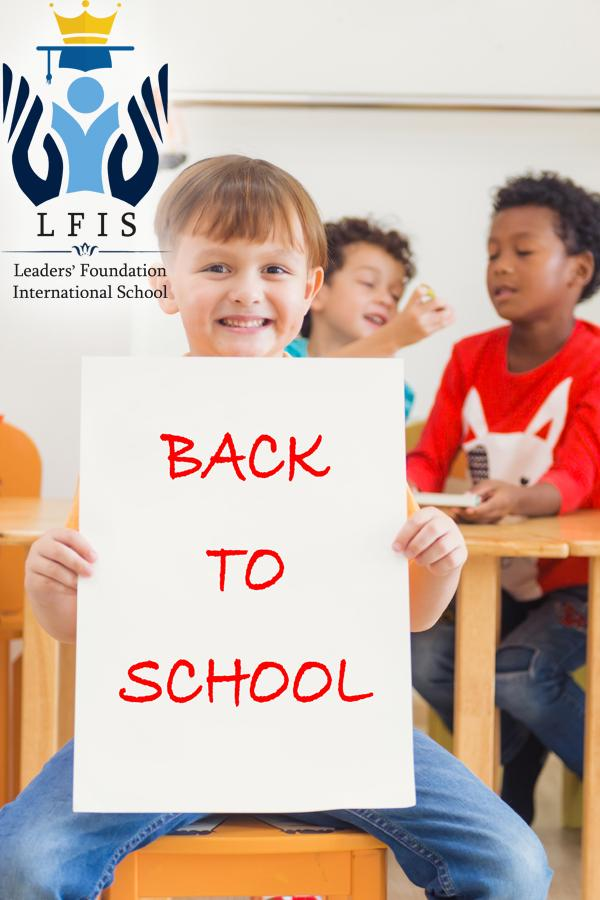
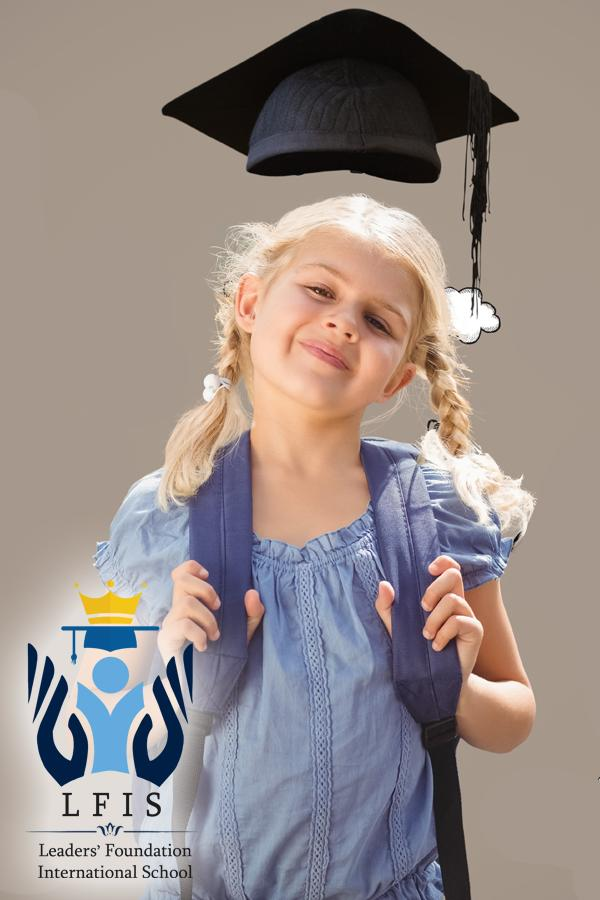
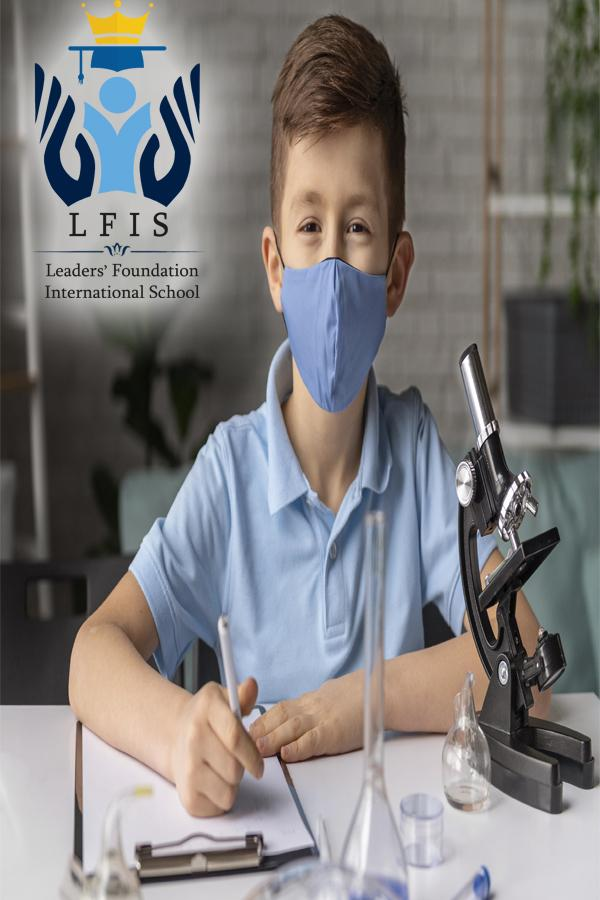

## General Superintendent’s Message

**From the General Superintendent’s Desk**

**Welcome to the Leaders’ Foundation International School**

At the heart of ***LFIS*** is our steadfast commitment to our motto – ***Think to bring about a difference***. We believe that children deserve respect and appreciation for their thoughts. They should be encouraged to be bold dreamers. That envision will lead them to impact the world through their creativity, innovation, communication, and exceptional character. In addition, we encourage our community to ponder together in order to systematically address how we might promote a diverse vision for the future. We are often reminded of the statement by ***His Royal Highness, Crown Prince Mohammed bin Salman*,** the creator of 2030 kingdom’s vision: ***“Success stories always start with a vision… and the most successful visions are those that build on strengths.”***

In this tradition, we seek to think with an open mind, dream with open eyes, and give with open hands facing a changing brilliant future for the Kingdom of Saudi Arabia. As we look to this shared future, we remember our successful past. The **Leaders’ Foundation International School** will provide an exceptional educational experience to students. Founded in 2021, LFIS seeks to build upon the ideals of emphasizing the community as a pathway toward excellence. It will grow into a world-class educational institution that relies on parent’s involvement, student’s voice, and a spirit of professionalism among our staff.

We welcome you to look around this site and reach out to us with any questions you might have. In addition, we encourage you to share your thoughts and opinions with us. Above all, our best ambassadors will be our students, who demonstrate the qualities and daily academic success of LFIS. I promise you that you will be proud of them for speaking about their dreams, success, difference that they have found at LFIS.

**Mrs. Maha Abdullah Al-dughayshim**

## Administration letter

On behalf of the leaders’ foundation international school Staff, we would like to extend our warm greetings to all new students. We are looking forward to working with you as partners in education. Here, at the leaders’ foundation international school, we are committed to provide a supportive and positive learning environment where the curriculum is chosen to help develop your children’s skills.

First years at school are essential in establishing well-built foundations for learning. Together we will work to achieve the highest possible outcome for each child’s learning experience. We aim to reach major development in your children’s reading, counting and writing skills throughout the year.

We also have a strong commitment to the health and safety of your children. It is a priority for us to provide our children with a healthy surrounding and build up positive thinking abilities that reflect the school’s values.

Constant communication between parents and school is the key to a successful partnership to support your children’s continued development and learning. The following letter serves as a manual guide to help you with all the details that you might need during the academic year.

Leaders’ foundation international school is looking forward to have a very engaging year full of fun and learning plans for all of us!

**Please accept my best wishes, for an effective working relationship between us.**

**Yours sincerely,**

**School principal**

**Mrs. Alaa Hassan Almatrafi**

## School’s Believes and goals

We believe that a happy child is a successful one. We are committed to providing a positive, safe and stimulating environment for children to learn, where all are valued. We intend that all children should enjoy their learning, achieve their potential and become independent life-long learners.

**Our goals are to**

- support and nurture the children’s and our own natural desire to be life-long learners.

- Provide a community where all children feel loved, respected and encouraged to develop to their fullest potential.

- Provide high quality education and childcare in a safe, respectful and inclusive environment that builds a foundation for life-long learning.

Provide support and encouragement environment with a welcoming atmosphere which creates a sense of belonging amongst the families which acknowledges and respects children from diverse family and cultural backgrounds.

## Who we are

- Leaders Foundation International School was established in 2021. LFIS are accredited by the Ministry of Education in the Kingdom of Saudi Arabia as an international school for pre-kindergarten to fifth grade elementary. It was built on a solid educational foundation to build distinguished and high generation, at the hands of its founder, Mr. Hassan bin Bakheet Al-Matrafi (former educational supervisor and ministerial foreign education in the Ministry of Education in the Kingdom of Saudi Arabia).
- We offer an American curriculum that serves a diverse group of students with a holistic approach that connects students and teachers, providing them with a collaborative and interactive environment that influences every aspect of education.
- Distinguished education and learning are provided to all in line with international trends of the vision of the Kingdom of Saudi Arabia and with community participation in an attractive and safe educational environment that raises skills and capabilities, enriches scientific research and encourages innovation and creativity, led by Ms. Maha Abdullah Al-Dughayshim (General School Superintendent).

### Think to make the difference.

## School’s Philosophy

Every student has an individual and a cultural set of experiences, skills and interests which must be considered in the teaching and learning process.

- A diverse student body enriches the school community and provides a wealth of experience and resources.
- A thorough education includes the development of the qualities of compassion, tolerance, respect for the rights and cultures of all people, the skills for the peaceful resolution of conflict and the development of environmental responsibility.
- School should prepare young people to provide leadership to meet the global challenges of the 21st century.
- School should foster an atmosphere of academic excellence and encourage intellectual inquiry and critical thinking.
- Achievement in physical, expressive and creative arts is an essential part of holistic education.
- School is a community where social awareness, thoughtful interaction and effective communication among students, parents and staff is fundamental to its well-being.

## Mission

To lead and hand-hold the early learning community in building a strong foundation for children. We foster a love of learning, encourage learners to experiment, and instill in them the confidence to bloom.

## Vision

To offer an unconventional, child-friendly, happy, and supportive learning environment that extends equal opportunities for learners to celebrate their inherent potential while transforming into well-rounded, confident, and responsible global citizens.

## Believes and Goals

We believe that a happy child is a successful one. We are committed to providing a positive, safe and stimulating environment for children to learn, where all are valued. We intend that all children should enjoy their learning, achieve their potential and become independent life-long learners.

## Core Values

- Leadership takes bold actions to transform education
- Empower: we believe in everyone’s potential
- Partner: we achieve more together
- Respect cultivates positive relationships.
- Honesty and integrity build a culture of transparency and trust.
- Helping others benefits communities and leads to personal growth.
- Embracing cultural diversity develops relationships and enriches life.
- Passion and commitment motivate, inspire, and empower life-long learners.
- Quality education has the power to make a positive impact on individuals and societies.

**Our goals are to**

- Building the child’s personality and supporting it with all stimuli of confidence and leadership
- support and nurture the children’s and our own natural desire to be life-long learners.

- Provide a community where all children feel loved, respected and encouraged to develop to their fullest potential.

- Provide high quality education and childcare in a safe, respectful and inclusive environment that builds a foundation for life-long learning.

Provide support and encouragement environment with a welcoming atmosphere which creates a sense of belonging amongst the families which acknowledges and respects children from diverse family and cultural backgrounds.

## Aims

- To inculcate school ethos, self-esteem, and personality development.
- To produce self-potent and outfitted global citizens.
- To build the self-esteem of the child through praise and valuing achievements.
- To value creativity both within and beyond school.
- To create an atmosphere that is both conducive to work and socially secure for all members of the school community.
- To encourage students to be independent, imaginative and resourceful.
- To signify initiative and believe that every individual has the potential to excel in different fields.
- To create a safe and secure environment wherein everyone feels involved.
- To foster a sense of justice, self-discipline and personal responsibility.
- To equip individuals with the social and self-expressive skills for life in a society that needs cooperative social and economic skills.

## Accreditation

Ministry of education in Saudi Arabia

Other: processing

## Learning Environment

Learning Environment
