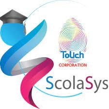

## Pre-k

This is a thematically organized structured play program with the opportunity for daily activities to socialize, play and grow with other children. Daily activities are planned in a safe environment rich in language, constructive play, active exploration and social interaction.

One of our overall goals in KG1 is the development of language skills in English. Students, through the use of themes and learning corners, learn about their environment. Students listen to and discuss story books. Our other goals also include socialization. We continue to develop fine motor skills through art, craft and crayons and pencil activities whilst gross motor skills are further developed through P.E. and movement. Teachers will guide and facilitate the children’s learning. Children are encouraged to work in large and small groups, as well as independently.

## Kindergarten

**KG1**

This stage is effectively the beginning of our full academic program. The children are taught using an integrated day approach. The main goal of the Early Childhood **LIFS** program is to give the children a better command of the oral language as the basis for thinking, pre-writing, and pre-reading. It builds on, improves, and increases the knowledge skills that children bring to school. It promotes an appreciation of the similarities and differences among people. It incorporates active learning through body movement activities, manipulation of learning materials, and interaction with others. Our other goal also includes socialization. Learning will be done in an entertaining way in active learning situations so that the children develop fine motor control, comprehension, vocabulary, knowledge of English language and culture through stories, physical exercise, songs and traditional games.

Children are encouraged to work in large and small groups, as well as independently. They are introduced to and involved with pre-reading and pre-writing activities which will lead them into becoming readers and writers. As well some pre-number activities with sorting, counting and matching activities form the foundation for future mathematical work. Daily activities incorporate P.E., art, and structured learning activities. Teachers will guide and facilitate the children’s learning.

**KG2**

This stage continues on from what was started in KG1.In KG2, students extend their oral language skills through stories, songs, rhymes, plays and dialogue. During the year, they are also gradually introduced to written language. At the same time, they are encouraged to begin writing. The children are taught using an integrated day approach. They are involved with activities and the skills of reading and writing which will lead them into becoming readers and writers. Beginning reading and writing skills are developed through whole group, small group, and individual instruction. As well number activities with sorting, counting and matching activities form the foundation for future mathematical work.

## Elementary

It is my pleasure to welcome you to Leaders’ Foundation International School. We are here to provide meaningful and challenging opportunities for both individual and community. We believe in empowering our learner’s minds with the desire and the means to reach their potential and goals.

We at Leaders’ Foundation International School believe in our young learners and their inquiries and we believe that these young minds need the proper tools that lead them toward the answers of these compelling questions. In our commitment to diversity, we must show our students how to be caring, risk takers and principled so they can act out of respect, courage and fairness.

We work hard to show our students how to make suitable choices and have respect for their own minds and bodies. We are keen to lead them to distinguish right from wrong and then choose to do what is right, so they can be persuasive and independent citizens.

**Elementary Curriculum**

**ENGLISH LANGUAGE ARTS (ELA)**

**Standard 1: READING:** **Word Recognition, Fluency, and Vocabulary Development**: word Recognition involves the understanding of the basic features of words: word parts, patterns, relationships, and origins. Students use phonics, context clues, and a growing knowledge of English and other languages to determine the meaning of words and become fluent readers.

**Standard 2: READING: Comprehension:** comprehension involves understanding grade-level-appropriate material. Students develop strategies such as asking questions; making predictions; and identifying and analyzing structure, organization, perspective, and purpose.

**Standard 3: READING:** Literary Response and Analysis Response to grade-level-appropriate literature includes identifying story elements such as character, theme, plot, and setting, and making connections and comparisons across texts. Literary response enhances students’ understanding of history, culture, and the social sciences.

**Standard 4: WRITING Process:** the writing process includes prewriting, drafting, editing, and revising. Students’ progress through these stages to write clear, coherent, and focused paragraphs and essays.

**MATH**

- **Number Sense:** number sense allows students to combine or decompose numbers naturally and solve problems using knowledge of the base-ten system and the relationships among operations.
- **Computation:** students should become fluent at performing computations in different ways, including mental calculations, estimation, and paper-and-pencil calculations using mathematically sound algorithms.
- **Algebra and Functions:** algebra involves the understanding of patterns, relations, and functions, as well as the representation and analysis of mathematical situations and structures using algebraic symbols.
- **Geometry:** geometry involves relationships among shapes and their properties and offers ways to interpret our physical environment. Geometry allows the development of students’ reasoning skills.
- **Measurement:** students should understand measurable attributes of objects and the units, systems, and processes of measurement, as well as be able to apply appropriate techniques and formulas to determine measurements.
- **Data Analysis and Probability:** through the collection and analysis of data, students can learn to make sense of and interpret information. This will enable them to make and critically examine statistical arguments.
- **Problem Solving:** problem-solving means engaging in a task for which the solution process is not known in advance. Good problem solvers develop a range of strategies for finding solutions to problems and learn to monitor and adjust the strategies they choose in the process of solving a problem.

**SCIENCE**

**The Nature of Science and Technology**, it is the union of science and technology that forms the scientific endeavor and that makes it so successful. Although each of these human enterprises has a character and history of its own, each is dependent on and reinforces the other.

**Scientific Thinking:** there are certain thinking skills associated with science, mathematics, and technology that young people need to develop during their school years. These are mostly, but not exclusively, mathematical and logical skills that are essential tools for both formal and informal learning and for a lifetime of participation in society as a whole.

**The Living Environment:** people have long been curious about living things – how many different species there are, what they are like, how they relate to each other, and how they behave. Living organisms are made of the same components as all other matter, involve the same kinds of transformations of energy, and move using the same basic kinds of forces.

**Social Studies**

**HISTORY:** Standard addresses the relationship between the past and the present. Students examine the relationship and significance of themes, concepts, and movements in world and Middle East histories.

**Civics:** in this standard, students learn what it means to be a citizen with rights and responsibilities in several communities: local, national, and world.

**GEOGRAPHY:** the standard focuses on the relationships between physical and cultural characteristics of Earth.

**Physical Education (P.E.)**

The emphasis of the activities program is to develop each individual in the following areas: Social and personal responsibility, Co-operative social skills, listening to and following directions, Movement concepts, Co-ordination skills, Manipulative skills.

**Subjects which are taught in Arabic**

- **Holy Qur’an**
- **Islamic**
- **Arabic**

**French:** The major aims are to develop a feel for the joy of learning a new language. It will start from Grade3.

## Assessment

<video controls preload="none" playsinline poster="/media/WhoWeAre-poster.jpg" src="/media/WhoWeAre.mp4"></video>

## FAQ

**What distinguishes the Leaders Foundation International Schools from other schools?**

**A unique approach to education based on pillars that include the following:**

- Developing the leadership aspects and building the child’s personality.
- Respecting and appreciating the child by teaching him his rights and duties.
- Develop the ethical aspects in a proper and balanced manner.
- Encouraging students on the rhetorical aspects in both English and Arabic.
- Teaching using the scientific methodology and focusing on the creative aspects and talents of students.
- Trained and qualified educational staff, advanced international curricula, educational activities.
- A stimulating learning environment equipped with the latest international technologies.
- An elegant educational building.
- Modern school equipment, indoor and outdoor playgrounds, and green yards.
- An educational school administration is keen to implement all of this.

**School times?**

**For this month we are available at two shifts:**

From 8:00am till 2:00pm

From 4:30pm till 9:30pm

**How to enroll in LFIS?**

**Visit: [leadersfis.com](/en/admission-en/)**

**School academic stages?**

Pre-k, KG1, KG2 **Boys & Girls**

**Girls:** Grade1, Grade2, Grade3, Grade4, GRADE5

**Boys:** Grade1, Grade2, Grade3

| Grade | Age by Aug. 30th |
|---|---|
| Pre-KG | 2 years and 9months |
| KG1 | 3 years and 9months |
| KG2 | 4 years and 9months |
| Grade 1 | 5 years and 9months |
| Grade 2 | Finish grade1 |
| Grade 3 | Finish grade2 |
| Grade 4 | Finish grade3 |
| Grade 5 | Finish grade4 |

**Age requirements:**

The basic criteria for placement are the age of the child by September 2021, as decreed by the Ministry of Education and the school’s assessment of the child during the admissions process.

**Is the** **school going to be online or in offline?**

School is subject to the instructions of the Ministry of Education in this regard. The school has a special strategy plan to achieve comprehensive quality and excellent education in both cases.

**What is the school curriculum?**

American curricula accredited locally and internationally.

**What are the nationalities of the school academic staff?**

Our Teaching Staff are highly qualified, experienced and English-speaking educators. They are selected to deliver an international curriculum which prepares students for international standards of academic excellence, as well as top-notch teaching staff to deliver Arabic language and Islamic studies from the Kingdom of Saudi Arabia.

**Do you have separate classes for boys & girls?**

Boys & Girls share the same classes in kindergarten only, and starting from Grade 1, classes are separated.

**How can I schedule a school visit or appointment?**

You can visit our website to schedule a tour, or you can make a virtual tour.

**Is there school transportation?**

Yes, transportation shuttle is available.

**Integrated School Management System**

