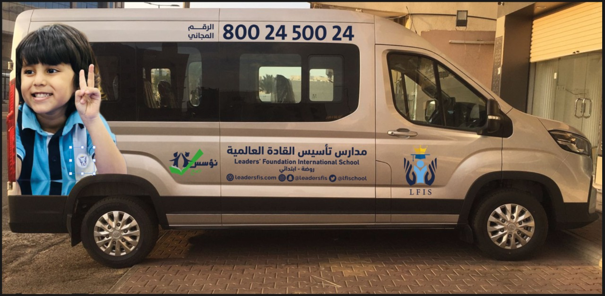
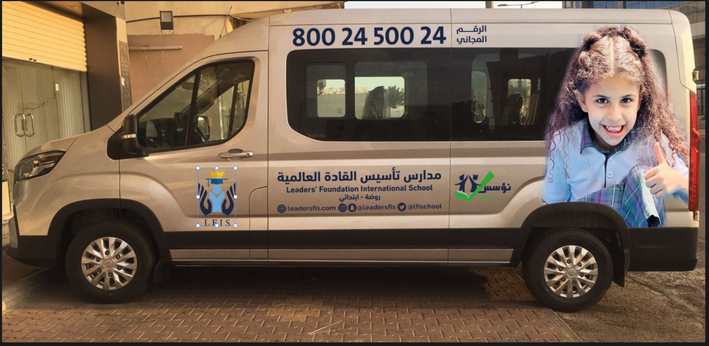
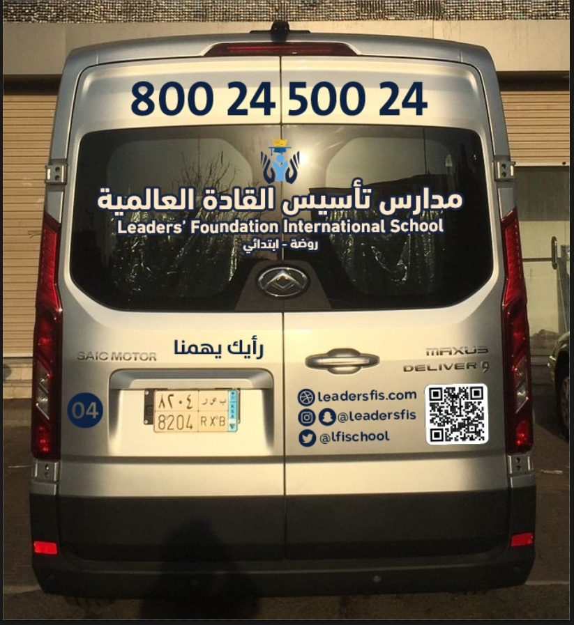

## Uniform

- Learners are required to wear the school uniform unless designated otherwise (see Behavior and Academic Policy). At the beginning of the academic year, parents should label all items with the learner’s name to prevent any loss of clothing.
- We believe in the learner’s right of self-expression. However, offensive items, excessive jewelry, and other forms of expression that hinder the process of learning are prohibited. The school administration reserves the right to determine the appropriateness of appearance and/or expression.

## Textbooks

- Learners’ textbooks and practice books are supplied by the school at the beginning of the year. The cost of these items is included within the tuition fees but in case of draw out they are excluded from the tuition fees and will be charged separately. The school also charges learners’ parents for copybooks, writing books, and agendas. Teachers should ask their learners to laminate or cover all textbooks, practice books, copybooks and agendas.

## Bus Service

- Learners should not open or hang out of the windows.
- Spitting, excessive noise, and littering are not allowed on bus.
- Learners cannot leave their seats or stand without permission.
- Learners should obey the driver and/or the bus supervisor.
- Seat belts should be used at all times.
- Learners should speak quietly not to distract the driver.
- Only water, sandwiches, and fruits are allowed.
- Use of offensive language and/or physical abuse is not tolerated.
- Learners may only leave the bus at their designated stop, unless permission is obtained from administration.
- Learners should always be on time. The bus should not be kept waiting either after school or at the designated stop in the mornings.

## Classrooms

Classrooms

## Library

Library

## Computer Lab

Computer Lab

## Mosque

Mosque

## Art Room

Art Room

## Cafeteria

Cafeteria

## Sports

Sports

## Health and Clinic

Health and Clinic
