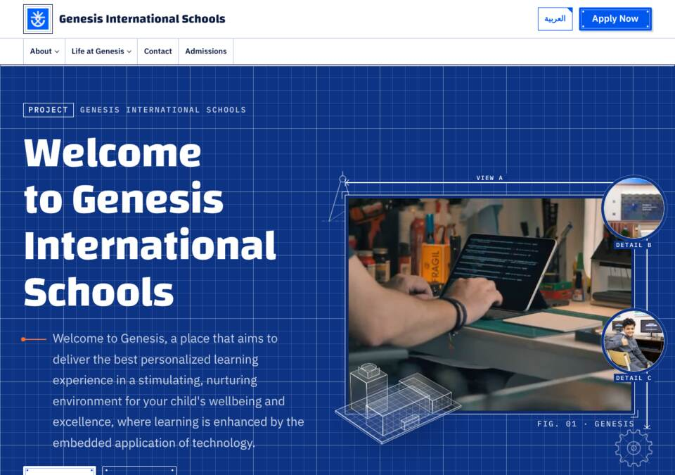

# Blueprint

The school as a STEAM drafting table. Built for older-skewing school groups (Genesis: Baby Class to Grade 12): confident enough for teenagers and parents, still lively.

Every page reads like an engineering sheet. Cool paper carries a fine drafting grid; the hero, call to action and footer are deep blueprint bands with white linework. Technical drawings plot themselves stroke by stroke. Figures sit on dimension lines, sections carry sheet numbers and scales, and the footer is the drawing's title block. Motion is precise and mechanical: firm ease-outs, no bounce.

## Parts

- **Palette** (`palette.ts`): light only. Cool white paper `#F5F8FD`, navy ink `#0A1A3F`, drafting blue `#0057EE` (close to Genesis `#0061FF`), and safety orange `#FF6B2C` as `highlight`, used for linework only, never behind text. All text pairs pass WCAG AA (body 16:1, muted 7.3:1, accent 5.5:1). The blueprint bands are mixed in `global.css` from `accent` and `ink`, so any palette mixed in produces its own blueprint. A dark set is included for mixing.
- **Type** (`type.ts`): Changa (display, Arabic and Latin, variable 400–800), IBM Plex Sans Arabic (body, Arabic and Latin, 400 and 600), IBM Plex Mono (labels, Latin; Arabic labels fall back to Plex Sans Arabic). Self-hosted under `type-fonts/` (SIL OFL) and bundled through `type-fonts/fonts.css`; `fontsHref` is empty. An English page loads the four Latin files (about 73 KB). An Arabic page adds the three Arabic files (about 124 KB), plus whichever Latin files its Latin words need.
- **Layout** (`layout/`):
  - `Header`: the sheet's top strip. Logo in a square plate (it turns a quarter on hover), ruled menu cells, the current page marked with a dimension line `|——|`, and sub-menus as crop-marked sheets.
  - `Hero`: the cover sheet. Copy with a mini title block (sheet, scale, date) on one side. The main photo or silent clip is mounted as "View A" with dimension lines and crop marks. Up to two more photos become round "Detail B/C" callouts. A compass and a gear plot themselves, and an isometric 3D model of a campus (`IsoModel.astro`, CSS 3D, no WebGL) assembles block by block on load.
  - `FeatureGrid`: figure sheets, "Fig. 01". Each has a line drawing (compass, flask, gear, book, atom, rocket, protractor, bridge, ruler) that plots in on scroll and re-plots on hover. Five items lay out two and three, six as three and three.
  - `Stats`: values on dimension lines with extension ticks and arrowheads that extend from the centre.
  - `NewsList`: a revision log, "Rev. 03 · date", newest first.
  - `CTA`: a blueprint sheet with an "Approved" stamp that thunks down, its lettered ring turning slowly.
  - `Footer`: ruled columns on deep blueprint, closed by a real title block (drawing, sheet, date, drawn by).
  - `Prose`: the page title in a title-block cover, the body on a white sheet with crop marks and a ruler edge. It also styles parts-list tables, drawing-register downloads, galleries, student name plates, notes and drafting-form fields.
  - Helpers: `Drawing.astro` (line art in code), `SheetHead.astro` (section head with sheet number and dimension rule), `sheet.ts` (the drawing-sheet words in English and Arabic, and numbers in the client's numerals).
- **Motion** (`motion/Motion.astro`, about 2 KB, no libraries). Everything starts from the finished drawing, so the page reads fully with no script or with reduced motion.
  - `data-reveal`: below-the-fold sections settle in by 14 px.
  - `data-draw`: drawings retract and then plot back stroke by stroke.
  - `data-split-words`: a plotter pen underlines each headline word in turn, whole words only, so Arabic stays joined.
  - `data-loop`: decoration pauses off screen.
  - On capable pointer devices, a drafting crosshair with a coordinate readout follows the pointer over the hero, in the client's numerals, and the 3D model turns slightly.

## Notes for other systems

- **SVG strokes** are matched by class (`.ln`), not by `[pathLength]`. Chrome does not restyle SVG descendants matched by a camelCase attribute selector when an ancestor's class changes, so a drawing revealed by a parent class stayed blank.
- **Never fade a 3D block with opacity.** Opacity flattens its 3D children, so the model fades its faces instead.
- **Arabic on a curved path.** Lettering on an SVG `textPath` comes out reversed and unjoined in Arabic, so the stamp ring only carries Latin text and falls back to tick marks.

## Scores

Lighthouse 12.8, mobile preset (slow 4G, 4× CPU), served compressed:

| Page | Performance | Accessibility | FCP | LCP | TBT | CLS |
| --- | --- | --- | --- | --- | --- | --- |
| Genesis `/` (English) | 100 | 100 | 1.4 s | 1.6 s | 0 ms | 0.013 |
| Genesis `/ar/` | 96 | 100 | 2.3 s | 2.3 s | 0 ms | 0.019 |
| LFIS `/en/` | 100 | 100 | 1.4 s | 1.7 s | 0 ms | 0.006 |
| LFIS `/ar/` | 95 | 100 | 2.3 s | 2.6 s | 0 ms | 0 |

The small layout shift is the hero headline when Changa replaces the fallback face. A metric-matched fallback face would remove it.

Checked in Chromium at 390 px and 1280 px, for every reachable page of both clients in both languages: no horizontal overflow, no console errors from the design, visible focus rings. The only console messages are YouTube embed permission notices on the imported LFIS news page.

## Previews

`previews/home-en-desktop.jpg` (Genesis), `previews/home-ar-desktop.jpg` (LFIS), `previews/home-en-phone.jpg` (Genesis), `previews/about-en-desktop.jpg` (Genesis).
