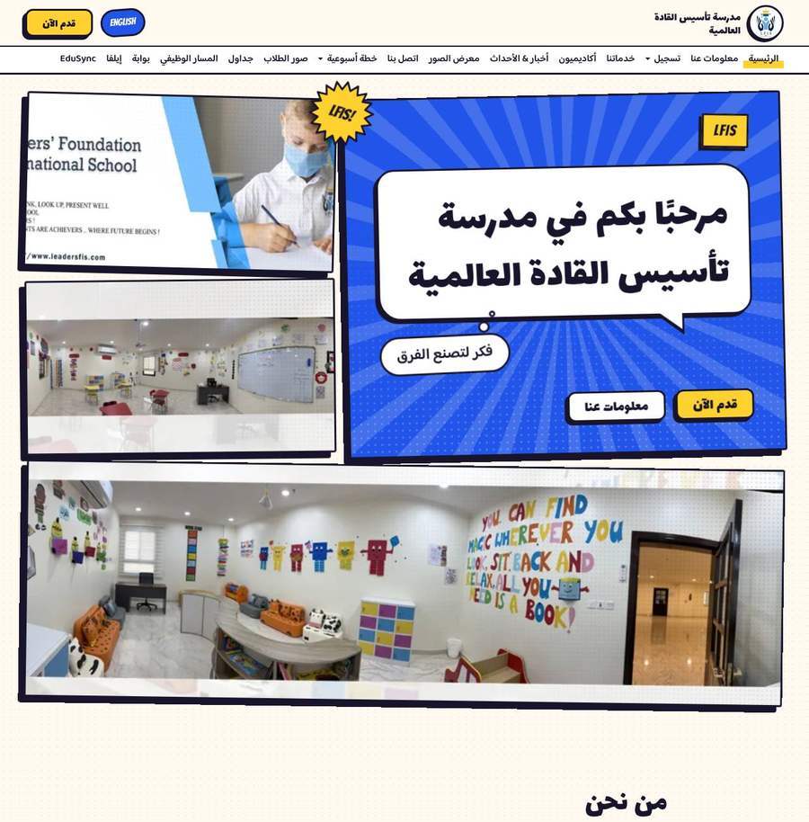
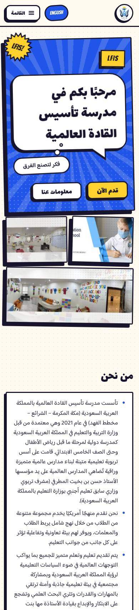

# Comic Class

The school story told as a bright comic book. Pages are laid out in panels with thick ink outlines and halftone dots, titles sit in speech bubbles, the motto floats in a thought bubble, figures are starburst stickers that stamp down, and every button is a chunky comic button that "prints" when pressed. Arabic pages read right to left, so the comic page, the panel order and even the offset shadows flip with them.

```
CLIENT=lfis SYSTEM=comic-class pnpm build
```



| Phone, Arabic | Phone, English |
| --- | --- |
|  |  |

## Tokens

- **Palette** (`palette.ts`, light only): warm paper `#FFF9EF`, ink `#17142B`, pop blue `#2154E8` (close to the LFIS logo blue) and comic yellow `#FFD12E` as `highlight` (close to its gold crown). `line` is the ink itself, because panels are outlined, not hairlined. A dark "night edition" exists for mixes with dark layouts.
- **Type** (`type.ts`): Bangers letters English headings; Lalezar is the Arabic display face (Arabic glyphs fall through Bangers to it); Baloo Bhaijaan 2 (Arabic and Latin, variable 400–800) is the body face. Display weight is 400 because Bangers and Lalezar ship one weight. The scale runs larger than baseline at the top (`--step-5` up to 5.4rem).
- **Layout** (`layout/tokens.ts`): near-square panel corners (`--radius-s` 4px), rounder bubbles and buttons, 76rem max width.
- **Motion** (`motion/tokens.ts`): `--ease-out` overshoots (`cubic-bezier(0.34, 1.56, 0.64, 1)`) so things land with a bounce; reveals travel 28px.
- **Layout globals** (`layout/global.css`): `--ink-w` (3px outlines), `--ink-shadow` and `--ink-shadow-big` (offset print shadows whose x offset flips on right-to-left pages), `--halftone`, `--halftone-light`, `--halftone-faint` dot patterns, `--dir` (1 or -1), and the `.comic-title` marker-stroke heading. Buttons: `.btn--primary` (blue), `.btn--ghost` (white), `.btn--pop` (yellow).

## Components

| Component | Treatment |
| --- | --- |
| Header | Paper masthead with an ink rule; logo in a round badge; the language switch is a tilted round sticker; sub-menus and the phone menu open as speech bubbles with tails. |
| Hero | A comic page: the title panel (speed lines, halftone, yellow caption box, speech bubble, thought bubble, buttons) plus up to three photo panels with halftone print and an "LFIS!" starburst. Long titles drop one type step. |
| FeatureGrid | Colored comic panels that take turns (blue, yellow, white, soft blue), each with a doodle drawn in code (star, light bulb, pencil, book) and a round arrow badge. Two per row on phones. |
| Stats | Starburst stickers on a halftone board; one or two figures get a compact board. |
| NewsList | A comic strip: white panels, dates in yellow caption boxes. |
| CTA | A blue panel with speed lines and a big "!" burst. |
| Footer | The back cover: ink background, zigzag top edge, yellow headings, social links as chips. Links listed twice are shown once. |
| Prose | Page titles in a speech bubble on a blue cover panel; the body is a white sheet. `h2` become yellow caption boxes, tables get an ink grid with a blue header and scroll inside themselves, downloads are tickets, galleries are tilted panels, student photos are trading cards, forms are comic forms. |

## Motion

All of it is CSS plus a 2.2 KB script (1 KB compressed, inlined in the page; `motion/Motion.astro`). GSAP and Lenis are not needed.

- **On load (CSS):** hero panels turn in like comic pages, one after another; the starburst stamps down; on capable devices the speed lines burst out once and the sticker wobbles three times.
- **Headline words:** each word jiggles once in sequence, from the visible state (whole words only, never letters).
- **On scroll:** panels below the fold pop in, stickers stamp down (`data-reveal="stamp"`), and items stagger.
- **Capable devices only** (`html.cc-rich`, set when the device has 4+ cores, 4+ GB and no data saver): panels tilt toward the pointer, hero panels tip back as you scroll past, and photos drift inside their frames (CSS scroll-driven animations where supported).
- **Reduced motion:** nothing moves. Looping decoration pauses when off screen.

Hooks other layouts can use with this motion part: `data-reveal`, `data-reveal="stamp"`, `data-reveal="slide"`, `data-split-words`, `data-tilt`, `data-loop`.

Two performance decisions:

- The speed lines no longer spin. Rotating a layer that large cost about 260 ms of main-thread time on a throttled phone.
- `main` clips horizontal overflow. Clipping on `<body>` is not enough, because the browser hands body overflow to the viewport. Without it, Arabic pages scrolled sideways while panels turned in, which counted as a layout shift.

## Fonts

The three families are self-hosted in `fonts/` (SIL Open Font License; see `fonts/README.md`) and declared in `fonts/fonts.css`, which `type.ts` imports so the build bundles it into the page's stylesheet. `fontsHref` is an empty inline stylesheet. With the engine's render-blocking Google Fonts link, first paint on a mid-range phone was about 0.9 s later. Each face downloads only when the page uses its script: English pages load Bangers and Baloo Latin only.

## Performance

Lighthouse 12, mobile preset (simulated mid-range phone, slow 4G), served with brotli and long caching for `/_astro/` the way Cloudflare Pages serves it. Measured 2026-10-22 on the LFIS content:

| Page | Performance | Accessibility | FCP | LCP | TBT | CLS |
| --- | --- | --- | --- | --- | --- | --- |
| `/ar/` (home) | 95 | 100 | 2.1 s | 2.5 s | 0 ms | 0.014 |
| `/en/` (home) | 98 | 100 | 1.6 s | 2.0 s | 0 ms | 0.002 |
| `/ar/about-us-ar/` | 94 | 100 | 2.0 s | 2.7 s | 0 ms | 0.002 |

For comparison, the baseline system scores 84 on `/ar/` under the same conditions, mostly because of the Google Fonts stylesheet.

All 51 LFIS pages render at 390px and 1280px in both languages with no horizontal overflow and no errors from the site itself. The news pages log errors from their embedded YouTube and Google Drive players, which come from the imported content.
