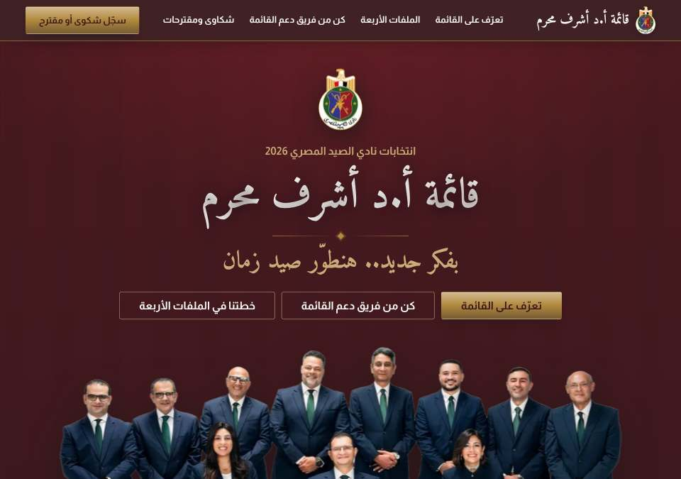

# Hall of Fame (قاعة الشرف)

A board-election list presented as the club's hall of honour. It was built for sports and social club elections, starting with Tanta Sports Club (Gharbia), where most voters are over forty. It needs to feel prestigious and settled and to be easy to read. Nothing in it is playful.

The site is laid out like a hall. Deep oxblood walls carry gilt frames. Each candidate is a framed portrait on a gallery wall, hung on cords. A spotlight finds the portrait as it scrolls in, and a brass name plate sits under it. Ballot numbers are gold medals that turn once and gleam. The programme files sit in a lit trophy cabinet, and the countdown is an engraved dial beside a brass scoreboard. The leader gets a grand portrait behind a velvet rope, with a stage light that comes up as you arrive. The ballot card is an engraved invitation. The reading rooms (team, files, support and complaints pages) are warm grey stone with wine ink, so long reading stays calm.

## Parts

- **Palette** (`palette.ts`): one committed look (`scheme: 'light'`).
  - **Stone and ink:** stone `#EFECE6` and `#FBFAF7`, ink `#1F1517`, muted `#4E4144`.
  - **Wine and gold:** oxblood `#6B1625` as `accent`, brushed gold `#B38B3F` as `highlight`.
  - **Mixed in `layout/global.css`:** the hall colours are mixed from these tokens: wall, deep wall, text on the wall, gold for text, and the brass and gilt gradients. So a palette mixed in from another system produces its own hall.
  - **Dark set:** a dark set (wine-black and gold) exists for other layouts to borrow.
  - **Contrast:** measured from the computed colours. All body text is AAA:

    | Pair | Contrast |
    | --- | --- |
    | Ink on stone | 15.1:1 |
    | Muted on stone | 8.2:1 |
    | Text on the wall | 13.9:1 |
    | Muted on the wall | 11.4:1 |
    | Wine on stone | 10.1:1 |
    | Gold kickers on the wall | 6.7:1 (labels only) |

    Gold is never body text on stone.
- **Type** (`type.ts`):
  - **Faces:** Amiri Bold (a classical Naskh) for titles, names, digits and the slogan. Almarai 400 and 700 (open, large counters) for everything else.
  - **Hosting:** the faces are self-hosted under `fonts/` (SIL OFL) and bundled through `fonts/fonts.css`, which `type.ts` imports. `fontsHref` is `'data:text/css,'`.
  - **Sizes:** body text is 18.4 px at its smallest (`step0` clamps from 1.15 rem), with a line height of 1.85. Headings use 1.45.
  - **Amiri subset:** the Amiri Arabic file is cut down with `pyftsubset`, keeping every layout feature, to the letters, marks, digits and punctuation that prose uses. That is 49 KB instead of 100 KB. Characters outside the subset fall back to Almarai. No client's content uses any.
  - **Weight:** an Arabic page loads six files, about 169 KB.
- **Layout** (`layout/`). Tap targets are 52 px (`--hof-tap`). Focus is a 3 px gold ring with an offset.
  - `Header`:
    - A wine bar with a gold hairline, the crest and the name in Amiri, and a brass call to action.
    - A short menu (an election list's four pages) sits in the bar. A long one (a school's dozen) gets its own wrapping row under the bar.
    - Below 1100 px there is a menu drawer.
    - It also preloads the fonts (see Notes).
  - `Hero` (school sites): a gilt-framed hero photo or clip with two small frames hung beside it, under a stage light.
  - `FeatureGrid`: engraved plaques. `Stats`: gold medals over brass plates on the wall. `NewsList`: a framed notice board. `CTA`: an invitation card. `Footer`: the wall, with the crest, an ornament and the legal line.
  - `Prose`: the page title, then the body on a stone leaf with a gold top border. It styles galleries, student plates, downloads, notes, forms, tables and quotes.
  - Shared pieces in `global.css`:
    - `.hof-wall`: the velvet wall.
    - `.hof-frame` and `.hof-frame__mat`: the gilt frame and its stone mat.
    - `.hof-plate`: the brass name plate.
    - `.hof-medal`: the gold medal, with its gleam.
    - `.hof-orn`: the gold rule with a lozenge.
    - `.btn--gold`: the brass button.
- **Election sections** (`layout/elections/`, all 14, loaded only by election clients with their own `elections.css`):
  - `ElectionHero`: the crest, the list's name in Amiri with one slow light sweep, and the slogan in gold under three stage lights. The whole team stands on a marble dais.
  - `Countdown`: an engraved clock dial whose hand sweeps once a minute in time with the real seconds left. Beside it, a brass scoreboard shows days, hours, minutes and seconds in Arabic-Indic digits. All engine hooks are kept (`data-el-countdown`, `[data-k]`, `.is-msg`, today and after messages).
  - `ProgramFiles`: the trophy cabinet. Each file is a lit glass cell with a downlight, a trophy disc, a brass plaque and a glass sheen. On phones it shows two per row.
  - `LeaderSpotlight`: a grand gilt portrait behind a velvet rope between brass posts, and a stage light that comes up on arrival. The leader's word (a video) hangs in a smaller frame.
  - `CandidateGrid`: the gallery wall. Portraits hang on cords from a gold rail, each with its medal, its plate and "view profile". The strip variant scrolls sideways with snap points.
  - `InterviewStrip`: a screening room of gilt 16:9 posters with brass play medallions.
  - `BallotCard`: the engraved invitation. It has a wine card, gilt corners and a double gold inset, and lists each group as medal, name and seat. It sets `--el-card-bg`, `--el-card-bg2`, `--el-card-accent`, `--el-card-accent2` and `--el-card-ink`, so the downloaded PNG matches.
  - `PageBand`: an inner-page title band on the wall, under a swaying light.
  - `CandidateHero`: a candidate's own portrait room. The portrait is in a large frame, the number is on a big medal, and the seat is in gold.
  - `MediaFrame`, `InterviewPlayer` (topic list with brass time badges), `PhotoRow`, `ClipGrid` (a compact grid when every group has one clip) and `Panel` (a stone leaf that steps aside for the supporters' app and the complaints form).
  - `elections.css`: restyles the engine's widgets:
    - The press-to-play video gets a brass medallion and an Amiri caption.
    - The supporters' app and the complaints form get 56 px fields, a gold focus ring, a brass selected tab, wine buttons and a brass progress fill.
- **Motion** (`motion/Motion.astro`, one small script, no libraries). Motion is slow and settled, with long ease-outs and nothing bouncy.
  - `data-hof-lit`: portraits below the fold wait dimmed, and their spotlight comes up as they scroll in.
  - `data-hof-reveal`: blocks rise 22 px. `data-split-words`: headings rise word by word, never letter by letter, so Arabic stays joined.
  - `data-hof-medal`: medals turn once on their axis, then a gleam crosses the gold.
  - The countdown hand sweeps.
  - On capable devices only (4+ cores, 4+ GB, no Save-Data):
    - `data-hof-sway`: stage lights drift.
    - `data-hof-depth`: the hero team photo moves at its own pace as you scroll.
  - Every loop pauses off screen.
  - Nothing on screen at load is hidden first. Which elements wait is decided by the IntersectionObserver's first report, after the first paint, so the script never forces a layout before it.
  - With `prefers-reduced-motion` or no script, everything is at rest and fully visible. There is no music.

## Notes

- **Font preloads (engine gap).** The engine has no hook for `<link rel="preload">`. Without one, the Arabic headings painted in the fallback face first and re-wrapped when Amiri arrived: a 0.10 to 0.13 layout shift on the election home.
  - `Header` now emits the preload links at the top of `<body>`. Preload is allowed in the body. The links use `?url` imports, prefixed with the build's base path when Vite leaves it out. They point at the same hashed files as `fonts.css`, which was checked under a gallery base path.
  - An Arabic page preloads all six files, because its spaces and full stops come from the Latin files. An English page preloads the three Latin ones.
  - A `fontPreloads` list in the type contract would let any system do this from `<head>`.
- **Supporters' app (engine gap).** The app is drawn by script into an empty `[data-el-sup]`, so the footer used to jump down when it appeared (CLS 0.48 on `/support/`).
  - `elections.css` now holds 62 rem for it while only the `<noscript>` placeholder is inside.
  - The engine could render a server-side placeholder of the join card's height instead.
- **Centring decorations in RTL.** Physical `left: 50%` with `translate: -50%` pushes a decoration off the page in RTL. Lights, cords and downlights are centred with `inset-inline: 0` (or `-50%` when wider than their box) plus `margin-inline: auto`.
- **Absolutely placed lights use fixed block offsets.** A percentage offset moves when the section grows while fonts load, and that counted as layout shift.
- **Engine-owned colours.** The share button keeps the engine's WhatsApp green. The Arabic zero (٠) in the visit counter is, by nature, a small dot.

## Scores

Lighthouse 12.8.2, mobile preset (simulated slow 4G, 4× CPU), served with compression (`serve`):

| Page | Performance | Accessibility | FCP | LCP | TBT | CLS |
| --- | --- | --- | --- | --- | --- | --- |
| Tanta elections `/` | 95 | 100 | 1.1 s | 2.9 s | 0 ms | 0 |
| Tanta elections `/team/ashraf-moharam/` | 97 | 100 | 1.1 s | 2.6 s | 0 ms | 0 |
| Tanta elections `/support/` | 98 | 100 | 1.1 s | 2.3 s | 0 ms | 0.006 |
| LFIS `/ar/` | 97 | 100 | 0.8 s | 2.6 s | 0 ms | 0 |
| LFIS `/en/` | 99 | 100 | 1.1 s | 2.2 s | 0 ms | 0 |

These were checked in Chromium at 390 px and 1280 px.

- **Every page:** all 20 election pages pass. They are right-to-left, have no horizontal overflow, load Amiri and Almarai, keep body text at 18 px or more and show no console errors.
- **Interactive parts:**
  - The countdown ticks in Arabic-Indic digits, with the dial hand in step.
  - The ballot card downloads as a wine-and-gold PNG.
  - The supporters' demo works from joining, through the code, to the dashboard with the link.
  - The complaints form shows five messages when sent empty, and a demo send succeeds.
- **LFIS:** the build has 51 pages. They are clean apart from YouTube permission notices that come from imported news content.

## Previews

- `previews/home-ar-desktop.jpg`: the election home hero.
- `previews/home-ar-phone.jpg`: the same hero at 390 px.
- `previews/team-ar-desktop.jpg`: the gallery wall.
- `previews/candidate-ar-phone.jpg`: a candidate's portrait room.
