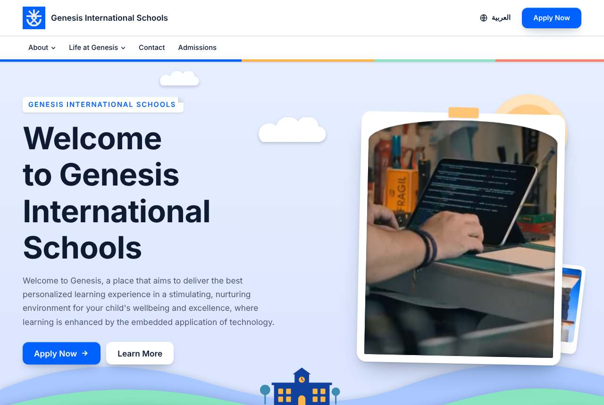

# Paper Layers

A crafted pop-up book for schools with older students as well as little ones. Every section is built from stacked sheets of coloured card with soft, layered shadows. The hero is a paper landscape that rises into place. Feature cards lie open like greeting cards, and figures pop up from their fold. It is calmer and more grown-up than Playground or Comic Class, but still full of small moments.

Made first for Genesis International Schools (Baby Class to Grade 12), with LFIS as the bilingual test content.

## The idea in one sentence

One signature moment (the hero landscape assembling itself), then quiet depth everywhere else: sheets fan out from under cards as they scroll in, and nothing moves on its own after that.

## Tokens

| Part | Choice |
| --- | --- |
| Palette | Cool paper board `#EDF0F5`, white card, school blue `#0061FF`, marigold `#FFB547`, deep ink `#0E1B33`. `scheme: 'light'`; a dark set exists for mixes. |
| Card colours | `--pl-blue`, `--pl-sun` from accent and highlight; `--pl-mint` and `--pl-coral` turned from them with `oklch(from …)` (with fallbacks), `--pl-deep` mixed from accent and ink. Any palette mixed in gets a matching set. |
| Shadows | `--pl-s1/2/3`: a tight contact shadow plus a wide ambient one, built from `--c-ink` so they follow the palette. `--pl-cut` is the inset shadow of a cut-out edge. |
| Type | Alexandria (display, Arabic + Latin, named after the Egyptian city) and IBM Plex Sans Arabic (body, Arabic + Latin, 400/600). Both OFL, self-hosted in `type-fonts/`; `fontsHref` is an inline `data:` stylesheet, and `unicode-range` means each page only downloads its own script. |
| Layout | 74rem max width, gentle radii (6/12/20px), generous section spacing. |
| Motion | Long soft ease-out (`cubic-bezier(0.22, 1, 0.36, 1)`), 180/480/950ms, 26px reveal distance. No overshoot. |

## Components

- **Header**: a white strip with a four-colour sheet peeking out under it, room for wide logos, dropdowns that pop up like card, and a paper menu sheet on phones.
- **Hero**: a sky with a three-layer paper sun and cut clouds; four hill layers with a paper-cut school (lit windows) on the middle one; the main photo or silent clip in an arched window cut into a card (`@engine/HeroMedia.astro`), with the second photo tucked behind it. The front hills overlap the card. Arabic pages mirror the hills layer by layer.
- **FeatureGrid**: greeting cards lying open on a big sheet: a coloured cover with a paper-cut icon (book, school, globe, atom, pencil, star) and a number, the inside page with the title. Covers swing open as they scroll in and lift on hover.
- **Stats**: a blue sheet; each figure sits on a stack of three paper discs that pops up from its fold line.
- **NewsList**: cards with a folded corner and a coloured sheet underneath that slides out on hover.
- **CTA**: a marigold invitation card with a paper sunburst that pops up as it scrolls in.
- **Prose**: a soft blue title card with its own hill strip and sun, then the body on a white sheet with fanned under-sheets. Old-site blocks are styled: `.gallery` (mounted prints), `.students` (photo cards with coloured captions), `.downloads` (tickets with a dashed stub; "not available" files show as muted text), `.actions`, `.embed`, `.note` (marigold slip), `.form`, tables (one-column tables become numbered document cards).
- **Footer**: a deep ink sheet rising behind two paper hill layers; the logo sits on a white card tab so any logo reads.

The shared utility `.pl-sheet` (in `layout/global.css`) makes any block a stacked sheet: `::before` is the top face and `::after` plus its box-shadow are the two coloured sheets under it. Set `--sheet`, `--under`, `--under-2` and the `--fan-*` offsets to change it.

## Motion

- **Load**: hill layers, the window card and the sun rise in sequence (CSS, `transform` only). Headline words settle in one by one (position only, so the largest paint is not delayed).
- **Scroll**: in browsers with scroll-driven animations (Chrome, Edge, Safari 26), hero layers drift apart in depth as the hero leaves the screen, sheets fan out, feature covers unfold, stat discs and the CTA sunburst pop up. All of it is CSS on the compositor (`translate`/`transform`), with no scroll listeners.
- **Fallback**: in other browsers the motion part adds a passive, rAF-throttled scroll listener for the hero layers only, on capable devices (4+ cores, 4+ GB, no Save-Data), paused when the hero is off screen. Everything else simply rests in its final state.
- **Reveal**: sections that start below the fold lift into place when they arrive (opacity plus a short rise and tilt).
- **Reduced motion**: nothing moves; the clip never loads; every layer, sheet and card is shown at rest.

## Measured

Lighthouse 12.8, mobile preset (simulated slow 4G, 4× CPU), with a hero clip, served compressed:

| Client | Page | Performance | Accessibility | Best practices | LCP | TBT | CLS |
| --- | --- | --- | --- | --- | --- | --- | --- |
| Genesis | `/` (English) | 100 | 100 | 100 | 1.1 s | 0 ms | 0 |
| Genesis | `/ar/` | 100 | 100 | 100 | 1.1 s | 0 ms | 0 |
| LFIS | `/en/` | 100 | 100 | 100 | 1.4 s | 0 ms | 0 |
| LFIS | `/ar/` | 100 | 100 | 100 | 1.4 s | 0 ms | 0 |

Every page of both clients (40 Genesis, 51 LFIS) checked at 390px and 1280px: no horizontal overflow, no console errors from the site (LFIS news pages log notices from embedded YouTube and Drive players in imported content). Keyboard focus shows a 3px outline; the language switch opens the matching page; with reduced motion the clip never loads and no animation runs. Mixes build: this layout with Playground's palette, Playground's layout with this type and motion, and Baseline with this layout.

Previews: `home-en-desktop.jpg` and `home-ar-phone.jpg` are Genesis; `about-en-desktop.jpg` and `admission-ar-desktop.jpg` are LFIS.

## Licences

Fonts are under the SIL Open Font License; the licence texts are in `type-fonts/`.
