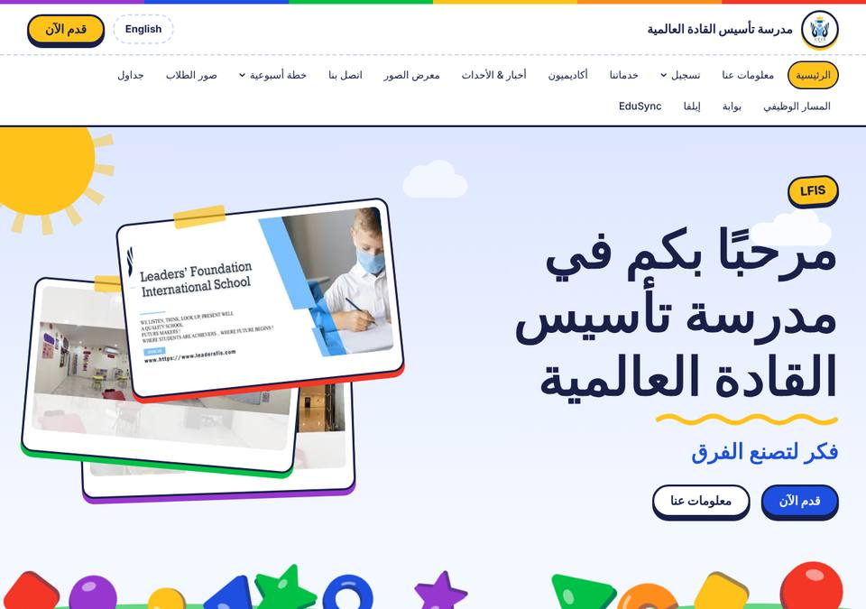
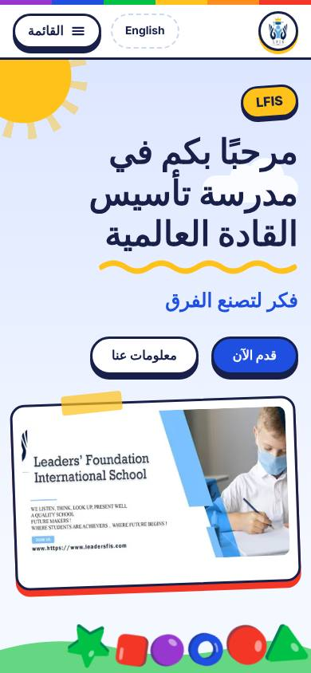
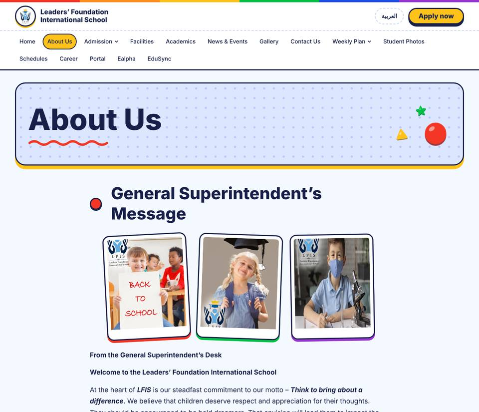
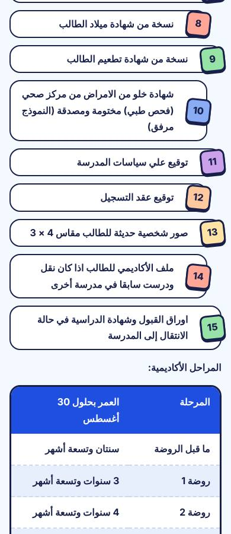

# Playground

A school playground made of chunky plastic toys. Bright primary colors, big rounded type, sticker-style cards, and a hero where toy shapes pop up, bounce and pile on the grass. Visitors can drag, flick and tap them; on a phone, tilting it rolls them. Made for kindergartens and primary schools, and it works in Arabic and English alike.

```
CLIENT=lfis SYSTEM=playground pnpm build
```

| Desktop, Arabic | Phone, Arabic |
| --- | --- |
|  |  |
|  |  |

## Palette (`palette.ts`)

Light only (`scheme: 'light'`): a playground is a daytime place. Playground blue `#1F4FE0` as the accent, sunshine yellow `#FFC21A` as the highlight, deep navy ink `#18204A` on a pale sky `#F4F8FF`. Every text pair passes WCAG AA (ink on bg 14.7:1, muted on bg 7:1, white on blue 6.5:1, ink on yellow 9.7:1). Dark values exist only for builds that mix this palette into an OS-following scheme.

The layout adds four **toy colors** in `layout/global.css`: `--pg-red`, `--pg-green`, `--pg-purple` and `--pg-orange`. They are not literals: they turn the hue of the palette's accent and highlight (`oklch(from var(--c-accent) …)`), so any palette mixed into this layout still gets a matching rainbow. Browsers without relative color syntax fall back to the accent and highlight. Toy colors are used for shapes, borders, tints and shadows, never for small text.

## Type (`type.ts`)

- Display: **Baloo Bhaijaan 2** (rounded and bouncy, Arabic and Latin).
- Body: **Rubik** (soft and readable, Arabic and Latin).
- Both are variable fonts (SIL OFL, licenses in `type-fonts/`) and self-hosted: four woff2 files, Arabic and Latin subsets of each, about 138 KB in total.
- `fontsHref` is a small inline `data:` stylesheet of `@font-face` rules, so no cross-origin stylesheet holds up the first paint. Loading the same fonts from Google Fonts cost the Arabic home page 13 Lighthouse points (performance 84 → 97).
- The scale is large and fluid: headlines reach 5rem.

## Layout (`layout/`)

Thick ink outlines (`--pg-border: 3px`) and solid offset shadows give every object a toy-like 3D base. Radii are chunky (10/18/28px).

- **Header**: a rainbow stripe, the logo in a round badge that tilts on hover, nav pills that take a different toy color each, a sunny "Apply" button.
- **Hero** (`data-playground`): a bouncing headline with a hand-drawn squiggle, tilted polaroid photos with tape, a sun and clouds. Eleven toys sit on a grassy hill (five are dropped on phones).
- **FeatureGrid**: each card is a piece of playground equipment drawn in SVG (slide, swing, seesaw, ball pit). Cards tip back in 3D on hover and squash when pressed. On phones they lay out sideways so they stay short.
- **Stats**: scalloped prize badges, like a sticker from the teacher.
- **NewsList**: tilted sticky notes with tape and date pills.
- **CTA**: a blue band with a slide and toys.
- **Footer**: a navy hill with colored social chips.
- **Prose**: a dotted title card with toys, section headings with toy-shaped markers in rotating colors, polaroid galleries, and ball bullets.
  - Numbered lists and one-column tables (like the admission requirements) become a **hopscotch** of numbered squares that zigzag down the page.
  - Two-column tables become chunky cards.
  - Student photos get colored frames and name pills.
  - Downloads, notes and forms are restyled to match.
- **Toy.astro** (internal): one shape (ball, triangle, star, block, ring, arch) drawn in `currentColor` with a darker extruded base and a shine.
- **Buttons** squash onto their base when pressed (`.btn`, `.btn--primary`, `.btn--ghost`, `.btn--sun`).

## Motion (`motion/`)

No animation library: the Web Animations API plus a small physics module. JavaScript per page is about 4 KB, plus 3 KB of physics on pages with a playground hero.

- Headline words drop in and land with a bounce. Only their position animates, never their opacity, so the text counts as painted at once (LCP is unaffected).
- Sections below the fold pop up with a springy overshoot as they scroll in. Anything already on screen is never hidden.
- **Hero physics** (`physics.ts`, loaded only on capable devices: at least 4 cores and 4 GB memory, no data saver):
  - The toys are circles under gravity. They bounce, roll, knock into each other, can be dragged and flicked, jump when tapped, hop out of a passing mouse's way, and slide with a phone's tilt (where the browser allows it without a permission prompt).
  - Toys move only with transforms from their CSS resting place, so there is no layout shift (CLS 0).
  - The loop sleeps when the pile is still, stops when the hero is off screen or the tab is hidden, and gives up after 14 seconds without interaction.
- Less capable devices get a one-off drop-in instead of the physics.
- `prefers-reduced-motion`: nothing runs. CSS-only touches (the squiggle drawing, the badge pop) end at their final state.
- With JavaScript off, the page is complete and the toys rest in a neat pile.

Motion tokens: fast 160ms, base 420ms, slow 700ms; the "out" easing overshoots (`cubic-bezier(0.34, 1.56, 0.64, 1)`); reveal distance 28px.

## Measured

Lighthouse 12.8, mobile preset (simulated slow 4G, 4× CPU), local static build of LFIS, 2026-10-22:

| Page | Performance | Accessibility | Best practices | SEO | FCP | LCP | TBT | CLS |
| --- | --- | --- | --- | --- | --- | --- | --- | --- |
| `/ar/` (home) | 97 | 100 | 96 | 100 | 1.4 s | 1.6 s | 150 ms | 0 |
| `/en/` (home) | 100 | 100 | 96 | 100 | 1.2 s | 1.5 s | 0 ms | 0 |
| `/ar/about-us-ar/` | 99 | 100 | 96 | 92 | 1.4 s | 2.1 s | 0 ms | 0 |
| `/ar/admission-ar/` | 100 | 100 | 96 | 92 | 1.2 s | 1.7 s | 0 ms | 0 |

Two scores come from the site, not from this system: SEO 92 on inner pages is their missing meta description, and Best practices 96 is a 404 for `/favicon.ico` (the client has no favicon yet).

Checked in Chromium at 390px and 1280px in Arabic and English, on home, about, admission, contact, student photos, news, facilities, academics, weekly plans and new registration:

- no horizontal overflow and no console errors from the system;
- visible focus rings;
- reduced motion leaves the toys still;
- drag, flick and tap all work.

## Mixing

- The layout works with any palette, because the toy colors derive from `--c-accent` and `--c-highlight`.
- The motion part does nothing playground-specific unless the page has a `[data-playground]` hero. With another layout it only does the word bounce and the reveals.
- The type part brings its own fonts.

Tested: `SYSTEM=baseline DS_LAYOUT=playground` and `SYSTEM=playground DS_PALETTE=baseline DS_MOTION=baseline` both build.
